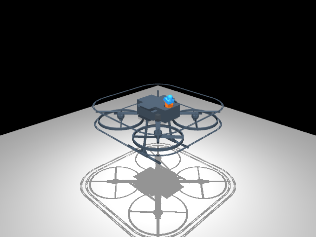
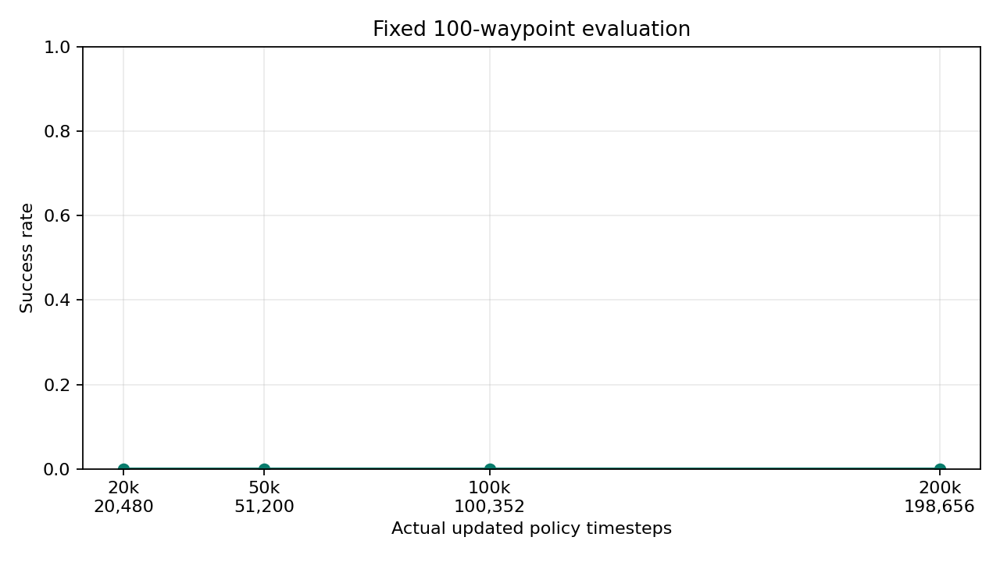
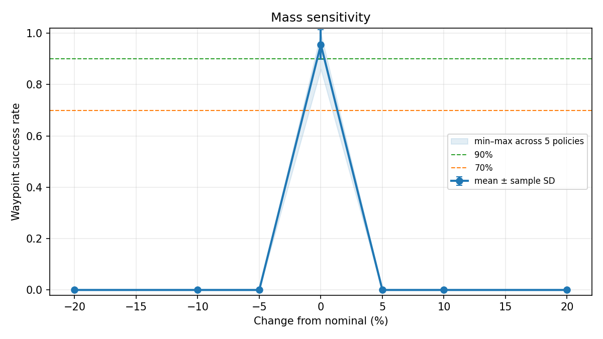
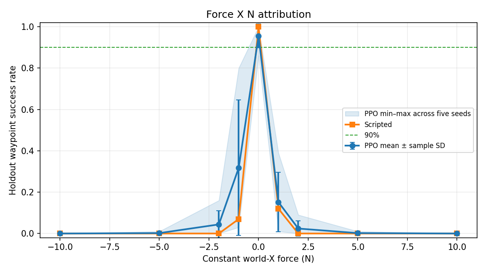
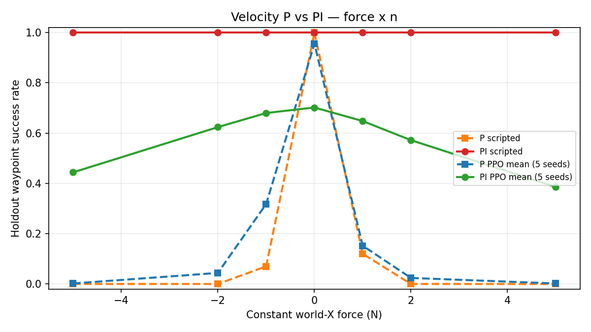

## AUTORL-R32 结果已复审，发布后准备独立学习对照（2026-10-17）

1886行旧trace描述性审计完成；analysisPASS，新学习NOT TESTED/因果UNVERIFIED。两组final操作的实际近目标平均速度约.50m/s，不能由约.67s相关峰宣称真实控制延迟；无电机/100Hz中间/每行LiDAR完整证据。1245选择PASS/15exclude，533旧文件/原178SOURCE/账本head32不变；余额951424训练步/28800预留秒stopfalse，训练/推理/新物理/新episode/Test0。

先核autorl_r32_staging_checks_01、真实Commit/正常OPSsync/远端phase_complete；之后查budget-stop-resource，下一候选R33为前32768步自然reset时均匀base下SHORT/ORIGINAL距离各.5（独立distance RNG）、后半按R28原距离/empty.5的单变量对照。保持fresh650a/CNN/Reward/PPO/原PI/held任务/65536预算，不加入R30/R31动作shim。须先新协议/源码/测试/独立审查/合法扣预算；此候选不提供执行许可。R32run_01/complete/exit不得重放，不盲试gain、不读Test/PX4/旧ZIP续训。以下为历史。

## AUTORL-R32 只读响应审计已执行，发布待核验（2026-10-17）

六条既有真实trace/1886行算术复核，analysisPASS，新学习NOT TESTED/唯一根因UNVERIFIED；没有新episode/物理/推理/optimizer/Test。last100Hz请求post-.01与40ms平均加速度中点post-.02区别明确，固定[3,7]s的正lag相关峰不冒称真实延迟。1245选择PASS/15exclude，533旧文件/原178SOURCE/账本head32不变，余额951424/28800stopfalse。

先独立结果复审/15文件Commit/正常OPSsync/远端，run_01/complete/exit存在不得重放。发布后据真实证据选单变量学习对照（提前原距离rehearsal或自身状态记忆），新协议/审查/实际扣预算前不训练；不盲试gain，不改旧FAIL、不读Test/PX4/旧ZIP续训。详见PHASE_AUTORL_R32_CONTROL_RESPONSE.md。以下为历史。

## AUTORL-R32 准备：既有控制响应只读审计（2026-10-17）

R31真实两feedback例失败0/2已发布24e8b51b94f0ce520ed150459cff3d81dee0427a，不重放。新REGff4d7eacfc995d6a3230613475882dfc14317996c63784b9730f90013db50b92，180SOURCE608ba9b7d4c62f4c791057896ecfc1085b84f40763b65ff897fe6726e4e161a0、EXECf0dd09e3a6594992afa1de3ee2d08aac19c31259d39118477aedc35a3095c710；只读取R27/R30/R31六条旧trace，固定[3,7]s和正lag网格，区分last100Hz请求与40ms平均加速度。不是新闭环、延迟识别或因果证明。完整1245选择回归/独立预审前不分析；5新增RED→GREEN、无训练/optimizer/物理/Test。账本head32/951424步/28800秒stopfalse，历史533保护不变。

先查checks/review/唯一analysisattempt，不重放旧launcher或实验。新阶段开发导致旧OPS SOURCE不匹配，须正常新登记不reset/reinit。实际结果后11节MDJSON图/独立复审/15文件Commit/正常sync/远端，再预算与stop/resource审核继续独立研究。以下为历史。

## AUTORL-R31 发布绑定已修复并复审（2026-10-17）

首次seal被原OPS readiness拒绝，尚未Commit；缺少两个报告元数据字段已补齐，新增1本地发布契约RED02→GREEN01，原错误收据及原报告MD字节保留。独立复审GO，仅证据绑定修复，178SOURCE/运行协议/raw/科学FAIL/1240选择测试数不变；507历史文件/账本head32、余额951424/28800stopfalse不变。先核autorl_r31_staging_checks_02及真实Commit/正常OPSsync/远端phase_complete，不能重复旧seal或run_01。

发布后下一安全研究：只读比较已存R27先验成功与R30/R31实际轨迹中的速度命令、PI积分、姿态及实测加速度时序，区分原网络输出映射与内环动态候选；不再盲试反馈gain，不重放旧病例，不在证据不足时直接重训。原授权仍可用，新的训练必须独立冻结并实际扣预算。以下为历史。

## AUTORL-R31 结果已复审，发布后继续独立研究（2026-10-17）

两个新显式速度反馈病例，冻结双成功对照FAIL，成功0/2、750策略/15000实际tick；仅hybrid动作诊断，不是网络学习成功。真实R30控制2timeout保持，原R28科学FAIL保持。1240选择PASS/15exclude，另2本地分析契约PASS；507旧文件/原173SOURCE/账本head32不变，余额951424步/28800预留秒stopfalse，训练/optimizer/Test0。

先核autorl_r31_staging_checks_01、实际Commit/正常OPSsync/远端phase_complete，再budget/stop/resources，依据本次结果独立冻结下一研究。不得重放run_01或原Val、旧ZIP续训/封存Test/PX4。若反馈成功可设计独立新初始化速度先验学习对照；若失败先解释反证，不盲目增加gain。下一实验必须新登记/审查并计入原累计预算。以下为历史。

## AUTORL-R31 真实速度反馈诊断完成，发布待核验（2026-10-17）

固定D=.3、Yaw清0两新例，冻结对照FAIL，成功0/2，750策略/15000实际tick；显式hybrid动作，不是learnedpolicy导航成功。旧R28FAIL/旧R30两timeout不变。1240选择PASS/15排除，另2本地分析契约PASS，507旧文件/原173SOURCE/账本head32不变，余额951424/28800stopfalse；训练/optimizer/Test0。

先独立结果复审、18文件Commit/正常OPSsync/远端，再按实际证据与预算继续下一独立安全研究。run_01/complete/exit已存在，不重放本诊断或旧Val、不读Test、不旧ZIP续训。详见PHASE_AUTORL_R31_VELOCITY_DAMPING.md。以下为历史。

## AUTORL-R31 准备：显式平移速度反馈（2026-10-17）

R30已正常发布远端64fe3ed22281f3929f8bb3efa36a47e864b85dc9/phase_complete=true，不重做。当前research/lidar-velocity-damping-diagnostic-r31，178SOURCE58a0c94fe2839482952c22a21316c154df99c1aadfd88161f0d415ca1cae04db、REG328721f314b7a3c8b560c24735826c0852ccc4779e98300948c03c166a1e08b6、EXEC35e551a8409baae94aed70c0d41f902c35cdcee39fdbc0e8fd891cf3efc068e8。新候选两例hybrid反馈对照：保持R30Yaw清0，fixedfinal模型已clip平移动作减去.3·当前ENU速度/动作尺度后再clip；不是原网络学习成功。180秒CPU1/每例375step、无optimizer/训练/Test；独立完整回归与预审前不执行。

余额head32/951424步/28800预留秒stopfalse不变。恢复查checks/review与唯一launchattempt/run_01/exit，若已存在不能重复；旧R30 OPS source mismatch是新登记开发，不reset/reinit。完整结果后MD/JSON/图/独立结果复审/18文件Commit/正常OPSsync/远端，再按预算继续安全研究。以下为历史。

## AUTORL-R30 结果已复审，发布后继续新单变量停稳研究（2026-10-17）

唯一Yaw动作清0两例均375step超时，合计750策略/15000实际tick；冻结双成功假设FAIL、工程完整PASS。进入.10m球分别38/37个真实样本，但联合低速度样本全0，终点速度.345/.350m/s，近目标往复运动在新trace可见；仅清Yaw不足以恢复停稳，不证明Yaw完全无影响。原R28FAIL不改，未训练/optimizer/Test；1234选择PASS/15排除、另2本地分析篡改契约PASS。483旧保护/原168SOURCE/账本head32不变，余额951424步/28800预留秒stopfalse。

先核autorl_r30_staging_checks_01、实际Commit/OPSsync/远端phase_complete，再查stop/resources。下一安全候选R31：利用新trace，独立预注册平移速度反馈的单变量非学习对照（可能显式damping=.3），保留R30Yaw清0基线，不直接修改原模型/PI/Reward，也不将改动作成功冒称学习成功。真正执行须新源码/协议、测试、审查与正常登记；新训练必须另预注册并计入剩余原授权。R30run_01/complete/exit已存在，不能重放或重试；不sealedTest/PX4/ZIP续训。以下为历史。

## AUTORL-R30 实际Yaw动作消融结束，发布待核验（2026-10-17）

唯一2新显式改动作empty轨迹完成，750策略step/15000实际tick；冻结双成功对照FAIL，新成功0/2、复用旧未改模型控制0/2。只对同一obs平移不改，实际YawRate清0，不是目标Yaw改0或原策略学习成功。1234选择PASS/15排除/0optimizer；483旧保护/旧168SOURCE/账本32不变，余额951424/28800stopfalse。R28科学FAIL不改。

下一步结果独立复审、18显式文件Commit/正常OPSsync/远端；run_01/complete/exit已存在，不可重放launcher/分析辅助或两例。真实发布后核budget/stop/resource，基于trace继续下一安全研究，不盲训/不Test/PX4/ZIP续训。详见PHASE_AUTORL_R30_YAW_ACTION.md。以下为历史。

## AUTORL-R30 准备中：Yaw动作消融（2026-10-17）

R29已正常发布远端c3b7197ed715638db7c1d18c962fe28f7b41ba1a/phase_complete=true，不重做。当前新分支research/lidar-yaw-action-ablation-r30，173SOURCE302b82788b90fc538146f51f1367e43f5fcfcf58a64dad8e816b57f4545c07f9、REG866768cd558c7036644392569cc9df654a68ecfea6f2ff1245dc35d979195090、协议e5f4cd89e0b3aae7b0885d8dca339ea5c37047454fa50e702f2fe8ef8c1f1d63。唯一候选2个新held原距离empty动作消融（final模型只将实际YawRate动作index3设0，同输入平移不改），180秒CPU1/每例375step，复用R28两timeout作控制不重放；无训练/optimizer/Test。当前完整回归与独立预审前不运行。真实预算仍head32/951424步/28800预留秒stopfalse。

恢复先查autorl_r30_checks_01/pre_review/唯一launchattempt及run01/exit，不能重复执行。旧R29 OPS source mismatch是新登记开发，不reset/reinit。完成MD/JSON/图/结果复审/Commit/正常sync远端后核余额继续独立研究，不将消融成功冒称原策略学习成功。以下为历史。

## AUTORL-R29 诊断已复审，发布后继续R30安全研究（2026-10-17）

唯一同背景237函数输入＋237重复完成，参数/optimizer不变；工程PASS、新导航/学习NOT TESTED。未支持远距离指令塌缩；XY朝目标响应增强，原prior直接速度反馈0使“制动相对prior减弱”不可判（NOT TESTED零参考）。训练后存在跨轴/Yaw指令候选，但闭环因果UNVERIFIED。旧R28final两个empty终点虽约.062/.066m，仍超时；不能用终点位置冒充速度<.15且连续5步成功。1228选择PASS/15排除/0optimizer，另2本地分析契约PASS；466旧保护不变、R28科学FAIL保持。

先核autorl_r29_staging_checks_01、真实Commit、OPSsync/远端/phase_complete，再预算head32/951424步/28800预留秒stopfalse与资源/stop检查。下一安全方向R30：围绕held任务近目标耦合/停稳设计新的受限非学习trace或单变量Yaw-action ablation，先冻结协议和审查，不直接重训。不得重复R29 run_01/237probe/旧helpers或36Val，不Test/PX4/ZIP续训；电脑关闭不执行。以下为历史快照。

## AUTORL-R29 实际函数诊断完成，发布待核验（2026-10-17）

三个可信R28模型同一真实LiDAR/heading/age背景、79反事实state各模型共237输入＋237重复，有限且确定性，参数/optimizer不变；无物理、新episode、训练或Test，不冒充闭环。far弱化候选[]；brake弱化候选[]，只限函数背景，不定唯一因果。1228选择PASS/15排除/0测试optimizer，466旧保护文件不变；R28科学FAIL保留，预算head32/951424步/28800预留秒stopfalse。

下一步独立结果复审、17路径显式Commit/正常OPSsync/远端；run_01与complete/exit已存在不可重放。发布后检查预算/stop/resource选择新独立研究。完整报告docs/PHASE_AUTORL_R29_POLICY_FUNCTION.md。以下为历史快照。

## AUTORL-R29 准备：同输入策略函数诊断（2026-10-17）

R28已完整发布远端4a757f43e6564ff9f7d656ae59a2dafe03a4ff2d/phase_complete=true，不重跑；训练65536步完成、科学FAIL。当前新分支research/lidar-policy-function-diagnostic-r29。拟3可信R28模型×79反事实state共237输入，固定真实step0 LiDAR/heading/age，不创建物理episode、不优化、不Test，不声称真实轨迹；严格180秒CPU1。REG36bc2b5fe68997470dcaa85317726c81c4333c5872861efd4aa3ce905c249c55、SOURCEd64b739465c66ca08494b3179c708298abd6ee23e230b8b64e407f941b9d4668、协议fb4c20db46abd4b1843fd33406bf958aaef2c4c5fbb25174b3327bf8ab3fc690，当前正在选择回归与独立审查，GO前不执行。余额head32/951424步/28800预留秒stopfalse不变。下次先查checks/review及唯一run_01/launch_attempt，不能重复执行。旧OPS source mismatch是新登记开发，不reset/reinit历史。

## AUTORL-R28 发布修正已审查，先核真实同步收据再进R29（2026-10-17）

publication-only新REG53431c954f89f8caa0f94b3aefd23c6cb9d3e0b3c231fab71ca8c5e99c2d2ccc、SOURCEe3e61d7d7e8cebfbf80498402d2a571e8c80ff0362376431f112f4e8e575e132，只移除新增测试EOF的1个额外LF，AST含行号相等/其余163SOURCE不变。新身份完整1221选择PASS/15排除/optimizer0；独立发布审查及正常register/recover/doctor/audit均PASS，原训练SOURCE94daaf…/协议/23raw/结果GO/旧R28注册不改。原R28工程运行65536完成、科学3FAIL2PASS总体FAIL；修复发布不等于学会导航。

不得重放旧seal/activation/训练或改历史账本。先查autorl_r28_publication_staging_checks_01、commit、researchctl-v2实际sync/远端SHA；仅全部通过后才能确认当前phase_complete。预算仍head32/951424步/28800预留秒stopfalse。下一安全研究为R29无optimizer的同输入策略函数诊断，查短课程之后长距离能力丢失；不重复36Val，不读取Test、不旧ZIP续训。电脑关闭不执行研究。以下段落是历史状态。

## AUTORL-R28 发布修正进行中：测试EOF格式，尚未Commit/Push（2026-10-17）

原R28训练/36Val完整结束、科学FAIL、独立结果GO均保留；旧28文件stage后的真实cached whitespace检查exit2，唯一原因test_held_goal_entry.py末尾额外LF。未Commit/Push，不能声称已交付；已仅解除自己的28路径索引，工作文件无损。正常新publication-only REG 53431c954f89f8caa0f94b3aefd23c6cb9d3e0b3c231fab71ca8c5e99c2d2ccc，164 SOURCE e3e61d7d7e8cebfbf80498402d2a571e8c80ff0362376431f112f4e8e575e132；只少一个测试LF/AST含行号完全相同，其余163SOURCE不变。旧执行SOURCE94daaf…/旧cc5注册/协议/attempt/23raw/两个GO不改，当前全套1221新身份无更新回归执行中。

下一步完整复验/新发布报告与独立GO→正常新register/recover/doctor/audit→31文件显式stage/actual working+cached checks exit0→单独Commit/正常OPSsync/远端。不得重跑旧seal、训练、旧attempt或改旧注册，不能关闭whitespace/身份检查。预算head32/951424步/28800预留秒stopfalse，PPO新增0。只有实际发布后才进入R29无optimizer同输入策略函数诊断。以下R28实际结果与启动段为历史，完整研究结论仍科学FAIL。

## AUTORL-R28 实验结果：新held-goal任务学习实际完成（2026-10-17）

关键负结果：新held原距离Val从step0手写先验4/6成功降到32768与final均0/6，两个empty从2成功变2超时；short三个checkpoint均6/6，全部36评价无物理/传感器失败。下降在短课程结束模型已出现，不能只怪后半段混合训练，也不证明唯一算法根因。发布后下一安全阶段R29优先做无optimizer、同输入策略函数诊断，区分距离范围与速度/制动映射候选；不重放36Val或相同训练，不读取Test。

fresh650a先验/65536步/1310232实际tick/512rollout/2048Adam/1024epoch/36新held Val/Test0，科学FAIL，五冻结判据{'held_empty_retention': 'FAIL', 'held_original_candidate': 'FAIL', 'held_original_learning_over_prior': 'FAIL', 'held_short_candidate': 'PASS', 'held_short_prior_retention': 'PASS'}。仅改变任务目标Yaw0→initialYaw，非同旧任务的性能增益；原Yaw0迁移NOT TESTED。1221选择PASS/15排除/测试optimizer0，419旧文件不变。实际31RESERVE/32COMPLETE；余额951424步/28800预留秒stopfalse，RESTART_REQUIRED，不续训旧ID。结果独立审查、Commit、正常OPSsync/远端核验仍须实际收据，未全交付不称phase_complete。详见[中文报告](PHASE_AUTORL_R28_HELD_GOAL.md)与mujoco/reports/autonomous_rl_held_goal_r28.json。随后检查预算/stop/资源，继续下一独立安全研究；不Test/PX4/设备。

## AUTORL-R27 最新：目标航向受限对照（2026-10-17）

新增两条同先验original-distance empty Validation、只改目标Yaw0→初始Yaw，成功2/2；复用R26原控制0/2，不重复。冻结heading_contrast=PASS，不等于原任务/学习/避障或泛化PASS。新386策略步/7720实际tick；训练0/optimizer0/Test0。1199选择PASS/15排除，363授权/42历史/旧150SOURCE不变，余额1016960/32400stopfalse，原R24仍永久FAIL/五科学NOT TESTED。详见[中文报告](docs/PHASE_AUTORL_R27_GOAL_HEADING.md)与mujoco/reports/autonomous_rl_goal_heading_r27.json。

下一步先独立结果复审、19文件显式Commit、正常OPSsync/远端，再核预算/stop/资源，从新证据选择单变量研究。旧训练gate仍closed，无新训练准入，不重试R24/ZIP续训；恢复见run01/complete不可重放两个诊断。以下准备段均为历史快照。

## AUTORL-R26 最新：中断checkpoint独立只读诊断（2026-10-17）

实际8个新empty Validation诊断/两个可信step0与32768模型，2368策略步/47360物理tick；短距离子集遗忘判据SUPPORTED_IN_THIS_SUBSET，不等于完整泛化或R24最终结果。训练0/optimizer0/Test0，原R24永久FAIL/五科学判据NOT TESTED，未续训或补原complete。1191选择PASS/15排除，363授权与15历史不变，余额1016960步/32400预留秒stopfalse。实际结果见[中文报告](docs/PHASE_AUTORL_R26_INTERRUPTED_YAW.md)及mujoco/reports/autonomous_rl_interrupted_yaw_r26.json。

下一步先完成独立结果复审、显式白名单Commit、正常OPSsync远端，再核余额/stop/资源，依新trace选择单变量研究；旧训练gate仍关闭，不能因本诊断PASS重试R24。恢复若见run_01/complete不得再次运行8episode。停止用独立authorized_rl request-stop；电脑关闭后不运行。以下准备段为历史快照。

## AUTORL-R25 最新：历史预算fixture隔离（2026-10-17，训练0）

仅改test_gae_credit测试源码，明确用固定R22历史预算reader替身跑历史unit正例/stop与forged负例，退出恢复真实读取。新增实际当前账本集成负例证明R24FAIL仍被原生产gate拒绝，生产门禁/预算/算法/模型未改。独立早审发现forged负例错误分支遮蔽，实际RED→GREEN修复后重冻02并完整1183选择PASS（224OPS/74无更新Tensor/885历史），15排除，非全仓；旧01收据保留，不冒充02。

363授权文件含head30与11额外R24证据字节不变；余额1016960步/32400预留秒、stopfalse，R24永久FAIL/科学NOT TESTED。当前无训练准入，不重试/ZIP续训。独立结果复审/Commit/正常OPSsync/远端状态以真实收据为准；之后只在已授权范围内设计新的无训练中间checkpoint诊断，不把它回填为R24完整结论。详见[中文报告](docs/PHASE_AUTORL_R25_LEDGER_FIXTURE.md)及mujoco/reports/autonomous_rl_ledger_fixture_r25.json。以下R25准备段为旧快照。

## AUTORL-R24 最新：跨boot系统重启中断，科学NOT TESTED（2026-10-17）

唯一Yaw覆盖训练永久FAIL/INTERRUPTED，不重试/ZIP续训。精确旧_BOOT_ID日志确认系统Reboot，具体发起者/worker最终信号/退出码未知；393完整更新到50304步/1572Adam/786epoch，旧progress50176不是最终步数。243结束Train=short131S19C20T、original22S22C29T；final65536 ZIP/summary/训练complete/主管终态缺失，新Val0/计划36、Test0。五科学判据NOT TESTED，不把中断或早期Train成功当完整科学结果。

146运行SOURCE冻结未改，384旧文件和16原raw不变；独立处置GO后仅追加30FAIL，保留65536step/3600s全额预留，余额1016960步/32400预留秒、stopfalse。训练前1181选择PASS/15排除/测试optimizer0；重启后OPS220PASS/2ERROR（旧正例耦合可变真实账本，R24被门禁正确拒绝），另74无更新TensorPASS，885历史未重跑。不隐藏失败、不改门禁。

当前先独立结果复审、显式白名单Commit/正常OPSsync并核远端；随后只做Level0/1修冻结历史fixture与R24失败封口证明，禁止训练，不能重放本ID或把32k ZIP当无损续训。详见[中文报告](docs/PHASE_AUTORL_R24_YAW_COVERAGE.md)及mujoco/reports/autonomous_rl_train_yaw_r24.json。下面RUNNING/准备段均是历史快照，不是重启指令。

## AUTORL-R23 最新：分布只读诊断（2026-10-16）

R22已发布55594504，科学FAIL不覆盖。R23仅只读完整R17/R22和12Train/6Validation，真实初始Yaw圆周距离与按layout结束统计已核对；发现同layout empty朝向覆盖差异，但因果UNVERIFIED，不把非平稳Train率与final Val当同策略差值。新学习/推理/扫描/物理/episode/Val/Test/optimizer全0，344授权文件字节不变，余额1082496步/36000预留秒stopfalse。1172选择回归PASS=217OPS+70Tensor+885历史/15排除，6新RED→GREEN；不是全仓或性能提升证明。

下一步完成结果独立复审、Commit/正常OPS sync与远端核验，再准备相对完整R17仅扩展Train起始Yaw的独立新manifest/协议；λ回到控制R17的.95，不能称相对R22只改Yaw。不得匹配封存Test、旧ID重试、ZIP续训或回写旧协议。详见[中文阶段报告](docs/PHASE_AUTORL_R23_DISTRIBUTION.md)与mujoco/reports/autonomous_rl_distribution_r23.json；实际发布状态以OPS收据为准。下一次恢复先核Git、授权head28、stop/余额及无活跃进程，读最新块，不重复本阶段。

## AUTORL-R22 最新：GAE单变量训练实际完成（2026-10-16）

R21已发布597ff08，R20永久FAIL/INTERRUPTED、科学NOT TESTED不重试。新R22相对完整R17只改GAE λ .95→.99，γ=.99保持；fresh手写先验/std.1、同中心化CNN/Reward/PI/课程reset.5/频率与24000rays。65536实际步/512rollout/2048Adam/1024epoch/1309969实际physics ticks完成（逐episode时间核对，非65536×20假定），36新Val/Test0；科学FAIL，五原判据{'empty_retention': 'FAIL', 'gae_credit_benefit_over_R17': 'FAIL', 'original_learning_over_prior': 'FAIL', 'short_candidate': 'FAIL', 'short_prior_retention': 'FAIL'}。原始checkpoint local-only，Final Checkpoint，不选32k。

1166选择测试PASS=211OPS/70无更新Tensor/885历史，15排除；13新RED→GREEN，分析5和来源/物理计数2另列。349旧文件不变，原事件1..26保留，仅新27RESERVE/28COMPLETE；余额1082496步/36000秒预留wall，stopfalse。完整CLI wrapper wall911.098s，worker至summary含延后Val的HWM1764.305MiB；全进程合计瞬时峰值未知，训练采样前缀单列。独立结果复审及远端同步状态以真实收据为准，未全交付不称阶段完成。

下一步先真实Commit/Push/远端核验，再核累计预算/停止请求/资源，针对上述实际结果自主制定独立新实验；不回填旧grant或失败，不重试原attempt，不运行Test/PX4/设备。详见[中文报告](docs/PHASE_AUTORL_R22_GAE_CREDIT.md)和mujoco/reports/autonomous_rl_gae_credit_r22.json；checkpoint RESTART_REQUIRED，不是无损恢复。

## AUTORL-R21 最新：SIGTERM事务边界离线修复（2026-10-16）

R20失败记录已发布5e95e3f9373753f408b6e2b92beb2670193e00cd，实验永久FAIL/INTERRUPTED、科学NOT TESTED，不重试或ZIP续训。R21仅修主管：第一SIGTERM锁存，在事务边界清理，保留event/head原子顺序，不异步raise。检查点之后/Popen中的信号可能短暂启动child后清理；完成事务越过最后检查点后优先提交，不承诺绝对零额外执行。SIGKILL/掉电无法保证，未实际关机或真实训练验证。

9项新标准库场景PASS（8项RED→GREEN＋1审查窗口刻画）；最终1153选择测试PASS=202OPS/66无更新Tensor/885历史，15排除。旧_01因新增测试导致最后SOURCE绑定失败，整体INCOMPLETE并保留；_02全套重跑。339份真实grant/head/26events/13attempts/raw未变，11COMPLETE/2FAIL；预算1148032步/39600秒预留墙钟、stopfalse，本阶段optimizer0/训练0/Test0/PX4及设备0。当前HEAD/远端完成以真实OPS收据核验为准，不把文档快照当训练授权。

下一安全动作：发布后独立离线登记已关闭R20失败的严格证据准入及新的GAE单变量研究方案，与完整R17比较；不能修改旧eligible_budget放行所有FAIL，不能重试R20或改变旧grant/账本。新训练需独立协议、测试、审查和剩余预算验证。详见[中文阶段报告](docs/PHASE_AUTORL_R21_SHUTDOWN_GUARD.md)及mujoco/reports/autonomous_rl_shutdown_guard_r21.json。旧pre-try IO窗口及guard强杀收据问题明确保留，非全生命周期解决。

## AUTORL-R20 最新：跨boot系统关机中断，科学NOT TESTED（2026-10-16）

R19已完整发布545c6c9a321956e1b89314f1fa8a63583e475cf1，不重放。R20新gamma .995单变量训练已跨boot中断，不能重复启动或从32k ZIP继续。原boot b5fd…的12:51:29 UTC kernel记录系统关机与向remaining processes发SIGTERM，紧随最后PPO日志约2秒；当前boot0b6…。可确认关机事件，不能证明具体worker最终信号、精确停止步数、是谁/为何关机。

最后完整更新40448/316rollout记录/1264Adam/632epoch，旧progress39936只是更早快照；确切最终训练步数NOT VERIFIED。291个结束Train=short246成功5超时（251）、original19成功15碰撞6超时（40），原距离实际32839才自然reset切换。final65536 ZIP/summary/complete/正常主管终态均缺，新Val0/计划36、Test0；科学五判据全部NOT TESTED，不把部分Train或缺测当gamma科学FAIL。两中间ZIP仅静态CRC/hash/JSON通过，不等于训练后Adam/预测重载通过；中断后不加载R20训练checkpoint或执行它的新评价episode。postboot接口测试自己的fresh模型、临时checkpoint及受控reset/step另列，不是R20评估或训练。

原16raw原样保存，新posthoc a3a83177…不是运行时异常捕获。独立审查发现boot范围遗漏后，新boot补充cbdaf53b…保留精确原boot关机消息，透明更正“当前oom_kill=0/笼统journal无entry不能排除旧boot OOM”，原收据未改。独立处置GO后仅现有BudgetStore.fail追加第26事件，R20永久FAIL/INTERRUPTED，保留全额65536step/3600s预留；余额1148032/39600、stopfalse，不退款/重置/重试。298旧不可变授权+16额外raw/原模型/87基线untracked保持。

SOURCE7e674406…129文件运行后未改。训练前1144选择PASS（193OPS/66Tensor/885历史）/15排除/0测试optimizer；重启后193OPS+66Tensor另259无更新复核PASS，未声称新boot重跑885。实际OPS postrun audit PASS d0291cd0…；这些不是训练完成。预审C0/I0、新legacy文案Minor1及R7/R18历史Minor保留；finalizer错误引用Important已启动前RED→GREEN修复。

最后资源样本wall538.279s/CPU529.889s，已记录训练HWM1657.746MiB、minMem6423.918MiB；完整wall、全程峰值/最低、最终physics ticks/exit均不可补猜。五图仅实际前缀，Validation图明确NOT TESTED。报告PHASE_AUTORL_R20_TEMPORAL_CREDIT.md、autonomous_rl_temporal_credit_r20.json。完整失败交付仍需真实结果复审/完整检查exit0后单独Commit/正常OPS sync远端；不得标训练完成或PHASE_COMPLETE。

下一安全动作：完成本次中断报告发布后，只开展Level0/1停机/SIGTERM/不可捕获中断的证据和账本语义诊断，模拟进程、优化器0，不注册无人值守后台服务。不重试R20、不旧ZIP续训、不把它当完整科学对照；新训练必须新独立假设/协议/测试/GO并核真实余额。原独立grant未被OPS零维护预算撤销，但当前训练执行NO-GO。普通失败交付后继续已授权安全工作；PX4/FASTLIO/实机/封存Test禁止。

下方为历史快照，不是重放指令。

## AUTORL-R19 最新：成功Reward排序与实际任务曝光审计PASS（2026-10-16）

R18含发布补充已正常OPS sync/远端4967f0abc53552730e660d8dbe5e2674709af138，不重放。R19唯一AUTORL_R19_REWARD_CREDIT_ONLY exit0/groupgone/complete，result e4b187eec7da23bcae213c92c9b36ec68ed751f7625ec8e19fd769fd7ee9ef1f。只读三R18 trace、两轮Train及ZIP JSON；train/optimizer/inference/physics/new episodes/Test0，OPS环境探针可import包但不加载策略。

真实gamma .99：32k成功回报8.059904，R16/R17final失败6.500101/5.725403，反驳“Reward偏好这两个失败”在三trace上的解释；+10成功bonus发生第283步，折扣只留.587658（5.8766%）。.995/.999/1只是相同记录反事实算术，不是训练结果/真实advantage。R16/R17原域每轮32686采样步，empty实际18166/27282（55.58%/83.47%），reset51/223与77/144（22.87%/53.47%）；两尾20/238步计曝光，不补Reward或terminal。不能将50%reset误作50%rollout、将惩罚总量误作梯度。

1135选择PASS（187OPS含9新增/63Tensor/885历史），15排除，0测试optimizer；REG96e61d65…/SOURCE7c363f49…124文件/EXEC643d79a0…/checksee0890fd…。独立预审C0/I0/新Minor0，R7范围Minor与R18发布流程Minor分别保留。全部299grant文件+7历史raw/旧模型不变，余额1213568step/43200s、stop=false，无预留/退款/重置。inner.213s/CPU.213s，launcher12.439s，wholeHWM237.645MiB，guard样本minMem7864.406MiB，连续全程最低NOT AVAILABLE；未观察OOM，既有ABI/3D warning披露。

完整报告PHASE_AUTORL_R19_REWARD_CREDIT.md、autonomous_rl_reward_credit_r19.json及三实际图；算法提升NOT TESTED。实际独立结果复审、完整检查exit0后单独Commit、正常OPS sync/远端核验仍以真实收据为准。下一安全研究R20优先只改变gamma .99→.995，相对R17其余条件不变，新初始化/新ID/65536步候选，先新测试/独立GO/预算stop资源，不能现在直跑或旧ZIP续训。不小幅盲搜更多empty比例。普通阶段继续长期研发，PX4/FASTLIO/实机/封存Test禁止。

下方为历史快照，不是重放指令。

## AUTORL-R18 最新：本例final未进入目标区，零训练动态诊断PASS（2026-10-16）

发布补充：首次结果提交1ee2d6f7568b0e6043386763410bee32c27884e7已远端核验，但提交前空白检查因stopping_dynamics.py:85多余末空行exit2，工具编排未中止而仍commit。明确保留该FAIL警告，不改已验证SOURCE/不重跑；独立确认19文件白名单/121 SOURCE/统计/授权无损，C0/I0、新发布流程Minor1，另继承R7 Minor1。phase/report公开补充另经精确审查/文档提交同步；后续先完整核验检查成功，再单独调用commit。不得声称原git show --check通过。

R17完整推07f2113b44e25f473dada365d1487b5b4df0f984，保持科学FAIL，不重放。R18唯一AUTORL_R18_STOPPING_DYNAMICS_ONLY exit0/groupgone/complete，result bd56b076e5f2241ce94a6843c6760709eaa70dc81ba64ee74f8edc4b8703384b。三个冻结策略各在同一开发Valempty fe85…新采样一次，共1033评价step/20660物理tick/3新诊断episode，训练/optimizer/Test0。新trace不是旧Val原始数据，terminal/步数/末距离/return四项以1e-8复现旧摘要。

R17@32k(同R16@32k)283步成功，首次near10.60s、11.32s达原5joint；near19/fast14/joint5。R16final与R17final各375步超时，整个15s都没有采样进入<.1m，min误差.101451/.123842m，末速.131937/.065627m/s已低于.15。因此本例不能归因“到了以后高速停不住”；不外推其他Val或控制不稳定。pre误差XYZ符号变化[3,5,0]/[0,6,0]/[0,2,1]仅25Hz现象。动作前state/head/age与动作后真实command/动力学/PI分开记录，没有未来状态输入。

1126选择测试PASS(178OPS/63Tensor/885历史)、15排除、0测试optimizer，另4方法契约。独立预审C0/I0/新Minor0，sign覆盖Minor已启动前RED→GREEN关闭；原R7 Minor保留，本轮不走该scheduler。SOURCE65386a82…121文件无运行后修改；6raw/三真实图/参数Adamnumsteps恒等。inner16.749s/CPU16.103s、launcher24.011s、HWM1444.871MiB、逐步guard采样minMem7025.723MiB；imports/load内部连续最低NOT AVAILABLE，未观察OOM。

全部299授权文件和7历史raw/旧模型不变，无预算事件，余1213568step/43200s、stop=false，不预留/退款/重置。报告PHASE_AUTORL_R18_STOPPING_DYNAMICS.md、autonomous_rl_stopping_dynamics_r18.json。实际结果复审/Commit/正常OPS sync远端仍以真实收据为准，未全交付不称phasecomplete。算法性能提升NOT TESTED；下一安全动作完整发布后设计单变量的到达速度/时间信用或声明反馈研究，不改PID、不把延长时限冒充旧15s PASS，不盲重训或旧ZIP续训。普通阶段继续长期研究，PX4/FASTLIO/实机/封存Test禁止。

下方为历史快照，不是重放指令。

## AUTORL-R17 最新：空场景重放未保留最终能力，科学FAIL（2026-10-16）

R16已完整推c8307c0f670787bb2a4897e14034452cbd57588f，不重复。R17唯一ARL_R17_EMPTY_REHEARSAL_SEED0主管exit0/账本COMPLETE，实际65536step/512rollout/1024epoch/2048Adam、1309913tick；summary950a588ea593f5eb0ece276748624e590efb231472a5c5aacb67098946da2f72，SOURCE590c0191…保持。唯一变量后半程原Train empty概率.25→.5，实际144加权reset中77empty；32k policy精确等于R16 33bf6699…，short251个结束结果223/18/10也完全相同。395reset，自然32850切课程，394结束Train=243成功81碰撞70超时，原Train143=20/63/60；尾238步仍计预算，未伪造成结束episode。

36新Val/历史复用0/Test0：short6/0/0→5/1/0→5/1/0，原1/3/2→2/3/1→0/3/3；两个empty0→2→0。五科学判据只有short candidate PASS，其余短保留/原学习/相对R16/empty保留FAIL，总FAIL。坚持FinalCheckpoint，不挑32k。Critic最后explained variance.956383不等于导航成功；训练分布改变后不能用总体Train成功率作公平泛化比较。Val没有逐step速度，不编造失败动态原因。

1119选择测试PASS（174OPS/60Tensor/885历史）、15排除、0测试optimizer，另5分析契约。训练前独立预审C0/I0/新Minor0，分析overall接线Important已真实RED→GREEN并复审关闭、旧方法/NO_GO保存。23raw/五图、三checkpoint真实权重/预测/optimizer重载，272旧授权+七R13/R15raw及历史模型不变。主管844.741s、wholeHWM1730.730MiB、训练采样minMem6644.664MiB，含Val连续最低NOT AVAILABLE；训练CPU累计单核97.53%。final ZIPe5f66c5e…/policy72979b21… local-only。

累计保守预留786432step/43200s，余1213568step/43200s、stop=false，24事件/12attempt，旧OPS零维护预算不撤销独立grant。完整文档PHASE_AUTORL_R17_EMPTY_REHEARSAL.md、机器报告autonomous_rl_empty_rehearsal_r17.json。当前最终独立结果审查/Commit/正常OPS sync远端仍须真实收据，未全交付不称phase complete。下一安全动作：完整发布后冻结R18零optimizer停稳动态诊断，优先补足新冻结策略动作与实际运动反馈证据；不得伪装成旧Val原始轨迹、重训/重试R17、warmstart或直接盲加步数。普通FAIL继续长期任务；PX4/FASTLIO/实机/封存Test禁止。

下方为历史快照，不是重放指令。

## AUTORL-R16 最新：停稳经验增加，最终原任务0/6，科学总FAIL（2026-10-16）

R15已完整推59e34070a166f195261abd6a3b62e051f20695b3，不重复。R16唯一ARL_R16_CENTERED_STD01_SEED0主管exit0/ledger COMPLETE，实际65536step/512rollout/1024epoch/2048Adam，1309123tick；summary bf3814e86f0402ed02748483453a8279079aabca3e4df0c93264a82fcc71668c、SOURCEf253400f…保持。唯一变量新初态std.3→.1，均值/Critic初态相同，不加载旧ZIP。473结束Train=247success175collision51timeout，short251=223/18/10、original222=24/157/41；自然32850切课程，474reset，尾20步另列。

36新Val/0复用/Test0：短6/0/0→5/1/0→5/1/0，原1/3/2→2/3/1→0/3/3。坚持FinalCheckpoint，不挑32k。短候选PASS、own短保留FAIL、own原学习FAIL、相对R14FAIL、停稳经验机制PASS，五项合取科学FAIL。短Train成功88.84%比R14的31.48%高，近目标高速率77.54%比89.89%低，但没转化为最终导航；两个原Val空场景32k成功、final又超时，不以终点距离替代连续停稳。

1106选择准入PASS（166OPS/55Tensor/885历史，15排除、0测试optimizer）及4方法契约；独立预审C0/I0/新Minor0/继承Minor1。三checkpoint实际参数/预测/optimizer重载，23raw/五图身份完整；final ZIPb3244a56…/policy25ff48c4…。246旧不可变授权文件+R13/R15七raw及原模型/七旧checkpoint保持。主管851.212s，wholeHWM1738.480MiB，训练采样minMem6877.793MiB；含Val连续最低NOT AVAILABLE。训练CPU样本单核98.16%，不是整机/fullVal CPU。

累计保守预留720896step/39600s，余1279104step/46800s、stop=false，不退款/重置。完整报告PHASE_AUTORL_R16_CENTERED_NOISE.md、autonomous_rl_centered_noise_r16.json；最终结果独立复审/Commit/OPS sync远端以真实收据为准。下一安全动作：完成本次交付后新R17，仅研究后半程原距离empty任务重放权重，先具体设计/可完成性既有证据核验/固定profile/测试/独立GO/预算stop资源，不能直接训练或重试R16，不旧ZIP续训。普通FAIL继续长期研究，PX4/FASTLIO/实机/封存Test禁止。

下方为历史快照，不是重放指令。

## AUTORL-R15 最新：新模型形成负速度反馈，尚不证明导航学习（2026-10-16）

R14已完整推1ab46a3d0c857ded3c0f496db0e54261a49b3005，科学总FAIL不改。R15唯一AUTORL_R15_CENTERED_FEEDBACK_ONLY exit0/groupgone，result SHA85d36387eff30e4ee02e0c4ee8c9bcd398c72e3f2886469ee65e9406dbeac846；R14两个新32k/final模型×62反事实输入=124新行，R13同类初态62仅复用，R4真实历史背景固定。训练/optimizer/物理/新扫描/episode/Val/Test均0。

三轴非零位置误差方向正确率各1，零state声明速度为0（结构），Yaw方向正确。final在+0.1m误差下正速度减负速度的声明指令差X/Y/Z=-0.432698/-0.345414/-0.087956m/s，初态全0；支持该固定背景上形成负速度反馈，不是物理制动稳定性证明。两个panel相对初态动作最大差.215104/.207756、先验保留均FAIL；改变初态不自动是Bug，不能拿保留或结构零输出替代导航成功。R14原Val仍1/6，不声称学习提升。

1097选择回归PASS（159OPS/53Tensor/885历史、15排除、0测试optimizer）及4分析契约；独立预审C0/I0/新Minor0，新register/recover/doctor实际通过，108源码身份不变。247授权文件+R13四raw保持，余1344640step/50400s、stop=false，无预留/退款。innerwall6.841s/CPU6.014s，launcher14.091s，wholechildHWM486.871MiB；两次模型前Mem采样最小8065.727MiB，不冒充全程最低。报告PHASE_AUTORL_R15_CENTERED_FEEDBACK.md、autonomous_rl_centered_feedback_r15.json及三实际图，最终结果复审/Commit/OPS sync远端以真实收据为准。

下一安全动作：完整交付同步后新R16单变量初始探索std0.3→0.1预检，保留中心化均值/CNN/Reward/全局LR3e-5/课程/物理不变；先新profile/初态均值一致性/测试/独立GO/预算stop资源，才可原授权下最多65536step/3600s新attempt。不是修改R14 ZIP继续训练，不重复R15。普通阶段继续长期研究，PX4/FASTLIO/实机/封存Test禁止。

下方为历史快照，不是重放指令。

## AUTORL-R14 最新：中心化对照完整结束，科学总验收FAIL（2026-10-16）

R13P已完整推76bd8065056fbb392e45d8f79b9e7c6aa5b394a5，不重复。唯一ARL_R14_CENTERED_ACTOR_SEED0已主管exit0/账本COMPLETE，65536实际step/512rollout/1024epoch/2048Adam，1309387真实物理tick；summary SHA0cd11a7161b2518ee9aa48c180d31435c723ae6f9978cd785128d788a074fafd，SOURCE87cd42df…保持。306结束Train=38success/144collision/124timeout，SHORT108=34/10/64，ORIGINAL198=4/134/60，尾23步未完episode另列；自然切换32901，307reset只冻结Train。

36条全新Val/Test0/旧评价复用0；短0→32k→final为6/0/0→6/0/0→5/0/1，原目标始终1/3/2。短候选PASS、相对历史R11 final0成功6碰撞改善PASS；短初态保留FAIL、原目标严格胜自身初态FAIL，科学总验收FAIL。结构零输出/手写初态不是学会避障，Train成功数也不是独立泛化。原Train814近目标采样779仍速度过大，停稳仍需研究，非唯一根因。

1088选择回归PASS（152OPS/51Tensor/885历史、15明确排除、0测试optimizer）及4分析契约；非全仓。三checkpoint真实参数/预测/optimizer重载核验，两个训练状态非空。220旧不可变授权文件+R13四raw保持。主管777.031s，whole child-tree HWM1789.898MiB，训练采样最低Mem7049.176MiB；含Val连续最低NOT AVAILABLE，无观察OOM。累计保守预留655360step/36000s，余1344640step/50400s、stop=false，不退款/扩大。

完整报告PHASE_AUTORL_R14_CENTERED_TRAINING.md、autonomous_rl_centered_actor_r14.json及五张实际图。最终独立结果复审、Commit、正常OPS sync远端以真实收据为准，未全部通过前不称PHASE_COMPLETE。下一安全动作：完成交付后进入R15，仅新R14模型的固定输入反馈诊断，先新身份/准入/独立GO，0optimizer/新物理episode/Test；再按证据选择单变量训练。普通科学FAIL不终止长期计划。禁止重试R14、旧模型warmstart、PX4/FASTLIO/实机/封存Test。

下方为历史快照，不得作为重跑指令。

## AUTORL-R13P 最新：已跟踪制品发布修复，等待真实同步收据（2026-10-16）

R13唯一网络预检PASS，local commit8492143未被覆盖；原OPS sync在git add阶段受历史*_pre*/目录ignore阻塞，未谎报Push成功。R13P新版本仅修改publication.py及对应单测：精确白名单的tracked项用literal add-u，fresh仍普通add，不force上传忽略raw，不改.gitignore。24sync文件显式覆盖R13旧18项与本次6项，可靠发布锚点仍79befa26…，不把未发布HEAD当远端。

真实隔离Git/Bare远端回归RED→GREEN，9publication测试PASS；当前145OPS+50Tensor+885历史=1080选择PASS/15排除/0optimizer，非全仓。REGf6befae4…/SOURCEc1aceb59…，独立预审C0/I0/新Minor0、版本register/recover/doctor及历史audit实际PASS。最终结果审查/Commit/正常OPS sync/远端以收据为准，未全部完成不标阶段完整。

R13旧report cece507b…、actual result1107e3fe…与四raw不变；模型/推理源码不改，但管理聚合源码在run后变化，最终组合版本R13实际预检明确NOT TESTED，不重跑旧attempt。全221授权文件与18events/9attempt保持，余1410176step/54000s、stop=false，无新增训练/optimizer/研究episode/Val/Test/PX4。OPS-only HWM27.840MiB不冒充整套Torch/MuJoCo峰值，后者统一值NOT AVAILABLE。

下一安全动作：完成R13P实际结果复审/显式Commit/OPS sync远端后，继续新R14中心化Actor独立65536step/3600s训练对照R11，先冻结profile/源码/36新Val/完整测试/独立GO再预留。不得重复R13、重试旧ID、旧checkpoint续训或放宽保护；PX4/FASTLIO/实机/封存Test禁止。普通发布阻塞修复后继续研究，非终止长期计划。

下方为历史快照，不是重复执行指令。

## AUTORL-R13 最新：Actor归零锚定接口PASS，尚无学习增益证据（2026-10-16）

R12已推79befa26f46f3b8bedd55320eed3bb3869dc5518、OPS远端核验phase_complete=true，不重复。R13唯一AUTORL_R13_CENTERED_ACTOR_PREFLIGHT_ONLY exit0/进程组清理，result SHA1107e3fe8388b6b36910a469a1a35324c51efac2a6fabeaf2dd41eb923876c5d。mean=f(当前特征)−f(同背景zero-state)，不改CNN/Critic/Reward/物理/PI；170857参数、Actor MLP两遍/CNN一遍。新policy20f5c226…，规范参数值SHA6312e99c…只用于比较，不冒充同一函数身份。

62固定反事实输入初态mean/value差均0，旧类新建参考+新类+新初态重载共186实际推理；只复用R4历史真实扫描背景，无新扫描/物理/episode/Val/Test/训练/optimizer。零state输出零是结构恒等式，非学会停稳。完整144OPS+50Tensor+885历史=1079选择PASS/15排除，新增4纯+12神经，非全仓。预审C0/I0；实际无参数结构损坏Important RED→GREEN，历史62/logprob补齐；最终结果审查及发布以真实收据为准。

inner wall6.595s/CPU5.774s，launcher13.660s，whole-worker HWM487.266MiB；模型前Mem8302.387MiB仅单次采样。派生绘图Path/bytes API错误已归档后处理修正，未重跑实验/改运行源码。SOURCEf968de2c…/REG1d32001d…/execution21af8a4e…保持，221授权文件/18events字节不变。余1410176step/54000s、stop=false，无退款/新预留；旧OPS零维护预算不撤销独立grant。新初态ZIP仅local诊断，不作正式训练初始化；历史R11 final也不续训，RESTART_REQUIRED。

下一安全动作：完成R13实际结果独立复审/历史audit/Commit/OPS sync远端，再R14独立65536步/3600s新初态中心化Actor对照R11低LR，其他课程/std/Reward/PPO不变；新类36个新Val、Test0，先新profile/冻结/完整测试/独立GO/预算stop资源核验才预留启动。可能表达受限，不能以结构零输出替代导航评价。普通阶段不结束长期研究；PX4/FASTLIO/实机/封存Test禁止。报告PHASE_AUTORL_R13_CENTERED_ACTOR.md、autonomous_rl_centered_preflight_r13.json。

下方为历史快照，不是重复执行指令。

## AUTORL-R12 最新：固定新模型反馈诊断完成，四panel先验保留FAIL（2026-10-16）

R11已完整推bd9095ff2f1b16a1bcd89a8ae699f4df47d1a05a，不重复。唯一AUTORL_R12_LOW_KL_FEEDBACK_ONLY结果SHAd4578edbd556c10e34189376c84b5554b46799318536e15d8e02c583906b771b、exit0/进程组清理；只读4个R10/R11新32k/final模型×62反事实输入=248新响应，复用R4真实背景/旧62初态参考，非310新推理/非新点云。训练/optimizer/物理/新扫描/episode/Val/Test全0。SOURCEc40fa232…、REGb54713cf…、execution2b19c122…保持。

相同固定输入下，R10@32k/final零state速度指令范数.381546/.739462m/s，R11低LR为.294207/1.190841；四panel先验保留FAIL。R11 final零yaw误差原均值2.10765裁剪到+1，五个yaw输入都+1、响应差0。只是离线指令，不是物理漂移/电机饱和/PX4故障，也不由偏离Scripted本身认定Bug。R11小KL仍伴随累计反馈偏离，未证明唯一根因或任何学习提升。

初始_01判据错误（误要求原先验不存在的负速度反馈）在执行前由基准测试发现，旧GO/源码/协议/失败收据原样归档，独立确认Important修复；最终_02完整140OPS/38Tensor/885历史=1063PASS，15排除、0测试optimizer，另3分析方法契约GREEN，不称全仓。全221授权文件/18events字节不变，余1410176step/54000s、stop=false，无新预留/退款。innerwall6.910s/CPU6.092s，launcher14.028s，wholeworker HWM486.340MiB；四次模型前采样minMem8279.930MiB，非全程最低。3raw/四图local身份完整，报告PHASE_AUTORL_R12_LOW_KL_FEEDBACK.md与autonomous_rl_low_kl_feedback_r12.json，最终独立结果复审/Git远端以收据为准。

下一安全动作：完成R12实际独立结果复审/历史audit/Commit/OPS sync远端；再R13零optimizer的Actor状态归零锚定表达预检，研究mean=f(obs)−f(同当前背景,zero-state)以抑制常量偏置。先新设计、测试、序列化/梯度及独立GO，不自动训练；若可行再独立协议对照R11，在原预算内执行。锚定零输出是结构约束，不是学习成绩。不能重放R12或从R11旧模型续训；普通阶段不终止长期研究。PX4/FASTLIO/实机/封存Test禁止。

以下为历史，不得重跑。

## AUTORL-R11 最新：工程COMPLETE，低KL但导航FAIL（2026-10-16）

R10已推21831fcc90d06756f431373643e75822b633eb7a，未重复。新R11仅将全局PPO LR3e-4→3e-5，唯一ARL_R11_PRIOR_LOWER_LR_SEED0已主管/账本COMPLETE：65536实际step/512rollout/1024epoch/2048Adam，1306104物理tick；summary SHA7f34a1e98eae2ef289becacb4d1086f7e5dbb0d686d2cae750610452d90b8f26、final ZIP9ec87ba5…，SOURCEab7544a0…未变。574结束Train=3success/481collision/90timeout；short106、original468，自然切换32811、尾0，575reset仅冻结Train。3成功均short，不证明学会导航。

短Val初态手写先验6/0/0→32k0/0/6→final0/6/0，原Val初态历史R3 PRIOR1/3/2→32k0/4/2→final0/6/0；30新Val/6旧评价复用/Test0。四导航/保留标准FAIL；首32更新KL从R10.071368降至.002472、机制PASS不等于任务PASS。全512 KL均.005162，Critic解释方差仍低；不唯一归因或盲重跑百万步。

1052选择回归PASS（131OPS/36Tensor/885历史，15排除/2既有warning）及5合成分析契约，不是全仓。23raw/5图身份完整、3checkpoint真实LR/optimizer/预测重载通过；194旧不可变授权文件及R9 17raw不变。主管wall828.729s、whole-worker HWM1790.242MiB含reload/Val，训练记录minMem7296.363MiB，全程含Val最低NOT_AVAILABLE。累计589824step/32400s保守预留，余1410176step/54000s、stop=false，不initialize/退款；旧L9永久FAIL与旧OPS零维护预算不改。完整报告PHASE_AUTORL_R11_LOWER_LR.md、autonomous_rl_lower_lr_r11.json，最终审查/远端以真实OPS收据为准。

下一安全动作：完成R11真实结果独立复审/历史audit/Commit/OPS sync远端，之后R12零optimizer新冻结模型反馈诊断，复用R4背景与62固定反事实输入，只分析R10/R11新32k/final权重，非重做旧R4模型，不发控制/不采新训练数据。先新身份/源码准入/独立GO再执行；根据方向/速度反馈证据决定下一单变量实验。普通科学FAIL不结束长期研究，真实停止/安全/预算/会话限制才交接。PX4/FASTLIO/实机/封存Test仍禁止。

以下为历史，不得据此重复启动实验。

## AUTORL-R10 最新：执行COMPLETE，四项科学标准FAIL（2026-10-16）

唯一ARL_R10_PRIOR_DISTANCE_SEED0已由主管及账本COMPLETE，实际65536步/512rollout/1024PPOepoch/2048Adam，summary SHAc9fa8bcc9b14fe441903e1f733e7496393e39a36a72c0d2f8e907fc9778ba2ca、final ZIP90726f17…，SOURCE5170a41…未变。425结束Train=1success/318collision/106timeout，short165、original260，实际reset切换33100，尾137步未结束仍计预算。唯一训练成功不证明学会导航；short Val从初态手写先验6成功降为final0成功0碰撞6超时，original final0/1/5，30新Val/6历史R3 PRIOR step0复用/Test0。四科学标准均FAIL，不重跑本ID/不warmstart。

当前research/lidar-prior-distance-r10，基线已推R9 0bdcfa999ef75a0b4f3d34a6498d76267348b7d3。1045项选择准入PASS（125OPS/35Tensor/885历史，15排除），另5分析纯契约RED→GREEN，不是全仓测试。23raw/5图local原始身份完整；主管wall772.024s，workerHWM1778.152MiB含reload/Val，训练记录minMem7093.902MiB；全程含Val最低NOT_AVAILABLE。168旧不可变授权文件与R9 17raw不变，事件15/16真实追加。累计524288step/28800s保守预留，余1,475,712step/57,600s，stop=false，不initialize/退款。结果与远端以PHASE_AUTORL_R10_PRIOR_DISTANCE.md、autonomous_rl_prior_distance_r10.json和真实审查/OPS收据为准，未全交付不称阶段完成。

下一安全动作：先完整结果独立复审/历史audit/Commit/OPS sync/远端SHA；再R11离线准入研究仅降全局PPO LR3e-4→3e-5（Actor/Critic共用），相对R10保持其他条件、原目标科学标准不降低。先验证真实schedule/optimizer组/step0 ZIP及重载新LR，明确旧L6协议仅base provenance不篡改旧hash；新profile/ID/协议/完整测试/独立GO/stop资源预算核验前不训练。R10先验在32k前已丢失、KL/clip大支持更新幅度假设但不证明唯一原因。PX4/FASTLIO/实机/Test调参禁止。普通科学FAIL不终止长期任务，真正阻塞/停止/预算或会话限制才停止。

以下为已结束历史过程，不能据此重复启动。

## AUTORL-R9 最新：非学习短目标解析Actor可完成性PASS（2026-10-16）

R8已完整推送2c731100f0c8888ffc7b0bf30f0a16c6d923895a，工程完成但三学习标准FAIL，永久不重跑。R9唯一AUTORL_R9_SHORT_PRIOR_FEASIBILITY_ONLY实际12/12短Train成功，701物理策略步/14020tick/28.04s合计仿真，0optimizer/训练/Validation/Test；result SHA3abcb783342e3f4429904a1a2188a0741e297df3eece98315af17589f61915d1。不是训练成果/避障能力，最终仍约8cm误差/.10m/s速度，只是原容差联合条件通过。

当前research/lidar-short-prior-r9，REGa958ac…/SOURCE35a4ef…/protocol2bf3f2…；1037项选择回归PASS（118OPS/34Tensor/885历史，15排除/2既有warning）。预审Important物理失败未停止已先RED→GREEN修复；两个Minor和测试夹具错误诚实记录。三图与逐步原始trace封存，worker wall15.256s/HWM1669.391MiB/runner前置采样minMem8704.117MiB、Health累计记录min8608.676MiB；预算169旧文件全字节不变，余1,541,248step/61,200s，stop=false。报告[PHASE_AUTORL_R9_SHORT_PRIOR.md](PHASE_AUTORL_R9_SHORT_PRIOR.md)及autonomous_rl_short_prior_r9.json，最终审查/Commit/远端以真实OPS收据为准。

下一安全工作：完成R9独立结果复审/历史audit/Commit/OPS sync远端核验，然后R10仅改变Actor初始化的独立距离课程PPO设计与准入。保持R8全部算法/Reward/预算/课程，补上相对R3/R8的先验×短课程交互项；明确区分先验保留与真实学习增益，不从旧checkpoint训练、不重跑已用ID、不因普通阶段结束停整个研究。PX4/FASTLIO/实机/Test调参仍禁止，不初始化/扩大原grant。

以下为历史过程快照，不得作为重复启动指令。

## AUTORL-R8 最新：执行COMPLETE，距离课程学习标准FAIL

唯一ARL_R8_REPAIRED_DISTANCE_SEED0已由主管及账本确认COMPLETE，永久禁止再次prepare/start或从checkpoint继续。actual65536step/512rollout/1024PPOepoch/2048Adam；summary SHA a6760dc61ff03a3895eb451f99d61d77513c643a3e8d4f8e31a55f556475dce4，final ZIP54c95adb…，SOURCE62b330…前后未变。当前branch research/lidar-repaired-distance-r8，基线为已推R7 05c7d9b；最终Commit/远端以OPS真实收据为准。报告PHASE_AUTORL_R8_REPAIRED_DISTANCE.md和autonomous_rl_repaired_distance_r8.json，独立结果审查/发布流程未全部完成前不宣称阶段已交付。

Train280=180碰撞100超时0成功；短任务128、原任务152，实际reset切换33070，末尾122步未完成episode仍计预算。30新Validation/Test0；短final0成功1碰撞5超时，原final0成功2碰撞4超时（原step0六条明确历史复用）。三科学标准FAIL，碰撞下降伴随超时增加，不等于学会导航。短21episode进过目标球却无joint停稳，不能断言从未靠近目标或单独归因速度/保持时长。1028项选择准入PASS/15排除，另3纯分析契约RED→GREEN；不是全仓PASS或实机能力。

主管wall720.338s，整worker HWM1696.816MiB含重载/Val，训练采样minMem9614.242MiB；全程最低Mem含Val NOT_AVAILABLE。无观察OOM/源变化/重试。原历史run/checkpoint/grant完整，R6仍永久FAIL。现保守累计458752step/25200s，余额1,541,248step/61,200s，stop=false，不initialize/退款。旧OPS零维护预算不撤销独立grant。

下一安全操作：先完成R8完整raw/图/MD/JSON独立结果审查、历史audit、显式Commit/OPS sync/远端SHA核验；未同步不跨阶段训练。随后新独立R9 Level1（0optimizer）短目标解析Actor反馈可完成性：新随机网络中按已审计公式赋解析均值，在相同12short Train用确定性动作检验原停稳条件；不是重复R5 Scripted、不是加载R8或L9旧权重、不是学习能力。若可行，再冻结仅改变初始化、相对R8随机均值的新PPO协议并完整准入，在原余额执行，不直接开训。课程/Reward/CNN/PPO/physics不因本次FAIL临时调参，Test封存/PX4/FASTLIO/实机禁止。普通阶段结果FAIL不结束长期任务，无停止/资源/会话等真实阻塞则继续安全研究。

以下是已结束过程快照，不能据此重复启动。

## AUTORL-R8 当前：已冻结修复后独立课程协议，训练尚未开始

R7已完整推送05c7d9bd63b4e48b461a876407d7f4917e746fe6并远端核验phase_complete=true；R6永久FAIL不重试。当前新分支research/lidar-repaired-distance-r8。新schema8/ARL_R8_REPAIRED_DISTANCE_SEED0、seed0/65536step/3600s/CPU1；原Reward/CNN/PPO/动力学/PI/24k模式不变，仅短.20m目标至32768后自然reset恢复原12目标。R7 adapter已接入真正worker入口，不从任何旧checkpoint初始化。protocol2eeb62e185b5c1bfe9de5aa6a299dcc5e546248aaa7b88661667ae719a58efbe；REGa5c17d…/SOURCE62b330…，预注册见autonomous_rl_repaired_distance_r8_prereg.json。

新5profile/1实际入口测试RED→GREEN，当前110OPS/33Tensor/885历史=1028项选择PASS/15排除/2既有warning，0optimizer。checks88736fa1…已绑定真实历史运行前后SOURCE，独立预审等待最终收据；尚未prepare/预留/start。所有旧run及grant目录143文件SHA不变，余额1,606,784step/64,800s，stop=false，不initialize/退款。旧OPS维护预算0不是独立grant撤销。

下一安全动作：独立预审精确GO后新register/recover/doctor→验证资源/停止/余额→prepare-repaired-distance显式核对上述协议SHA→唯一start-repaired-distance。启动后只监控同一ID/不重试，预留后应余1,541,248step/61,200s，不能把预留当实际完成。若未知或失败先保留现场，不删attempt、不warmstart。运行期SOURCE冻结；checkpoint0/32768/65536，关闭Train后30新Validation，originalstep0六条明确复用历史不计新执行，Test0。完成实际结果/图/MD/JSON/独立复审/Commit/OPS sync远端后继续下一安全阶段；不自动PX4/FASTLIO/实机/Test调参。

下方是历史快照，不是重复执行命令。

## AUTORL-R7 最新：离线记账修复，完整回归通过（2026-10-16）

分支fix/lidar-distance-accounting-r7，基线2f6e5c297c2a12f7e69a8328d90aee11eed97589（R6已诚实FAIL发布且远端核验，永久不重试）。新显式adapter保留12base抽样与24Train任务真实身份，完整TrainingMetrics→FormalHealth真实step GREEN，不改R5/原Navigation/Reward/PI/动力学/旧worker。_01独立NO_GO I1故障身份缺失已先RED2失败→GREEN；最终_02 REG486b2730…/SOURCE1eaa6b1f…完整1022选择测试PASS（105OPS+32Tensor+885历史，15排除/2既有warning），0optimizer/训练/Test；不是学习性能提升或全仓PASS。报告PHASE_AUTORL_R7_TASK_ACCOUNTING.md与autonomous_rl_task_accounting_r7.json；最终独立GO及Git交付以本地真实审查/OPS远端收据为准，不用文字自行认证。

当前独立grant累计393216步/21600s保守预留，余1,606,784步/64,800s、stop=false。R7执行前后整个授权目录143文件、所有旧run/R6原10文件、R5报告字节不变。原L9永久FAIL，R6唯一0accountedstep/一次20tick物理返回/0optimizer失败不退款，不可继续step0。旧OPS维护零预算不撤销独立grant，不能initialize或改旧协议。

下一安全动作：确认R7最终独立GO→新版本register/recover/doctor→历史audit→显式文件Commit/OPS sync/远端核验。随后自主进入独立R8修复后距离课程协议：新固定ID/schema/精确pin R7发布证据，复用原worker加显式adapter，只变课程目标分布，不使用任何旧checkpoint初始化；新协议测试/预审完成前不训练。预拟65536步/3600s、CPU单worker、短目标至32768后自然reset恢复原目标、原Reward/CNN/PPO保持。R8不是重试R6；R6协议/attempt永久保留。Test封存/PX4与设备禁止，资源/stop/未知状态阻塞则安全停。

以下为历史快照，不能作为重复执行命令。

## AUTORL-R6 最新：FAIL，必须先离线修复（2026-10-16）

唯一ARL_R6_DISTANCE_SEED0已FAIL，禁止prepare/start重试或从step0继续。第一条实际20tick/.04s transition返回后，新短目标task身份不在旧TrainingMetricsEnv的12个base白名单，被安全拒绝；已完成训练记账步数0，optimizer/episode/新Validation/Test均0，不是PPO学习失败。完整现场/step0 ZIP已封存local-only，运行源码ca83fb16…未改；原预审GO遗漏此Important消费者契约，1011项选择回归PASS不等于完整链通过。

预算保守预留不退款：累计393216步/21600s，余1,606,784步/64,800s，stop=false。R5已推送d4971529…，R6最终Commit/远端以OPS实时收据为准。阶段报告PHASE_AUTORL_R6_DISTANCE_CURRICULUM.md、机器JSONautonomous_rl_distance_curriculum_r6.json。失败报告可同步但OPS保守phase_complete=false，不伪造PASS。

下一安全动作：先完成R6失败结果独立审查及Commit/Push远端核验，再独立R7 Level1修复。显式保留base/task双身份，只在记账边界使用受审Train任务白名单，不删除过滤/伪造base身份，不准入Val/Test；完整TrainingMetricsEnv→FormalHealthMetricsEnv真实step、跨课程阈值、未知身份/失败锁存/Checkpoint状态先RED→GREEN，0optimizer。修复发布及新审查后才可另立独立训练协议和ID，不重试R6、不重置原grant。PX4/FASTLIO/实机禁止，Test封存。当前训练因已知Important暂BLOCKED，离线修复自动继续。

以下为历史过程快照，不是当前执行命令。

# MineUAV-Learning

## 当前：AUTONOMOUS-RL-RESEARCH-V1

[R5短距离可完成性](docs/PHASE_AUTORL_R5_SHORT_GOAL.md)：12个新0.20m Train任务真实物理基线12/12按原标准停稳，701策略step／14020物理tick；0训练/optimizer/Val/Test。1003项相关测试PASS、15排除，原0.35m静态目标冲突在运行前修订并保留证据。仍非学习成果。预算余1,672,320步／68,400s不变，完成独立结果复审和远端同步后自动进入R6课程PPO准入与执行，不重复旧训练。

[R4冻结策略反馈诊断](docs/PHASE_AUTORL_R4_FEEDBACK.md)已唯一完成：11 checkpoint×62反事实输入，真实单背景雷达、0物理step／0optimizer／0Test。解析先验训练后反馈明显偏离；R3随机／解析final的零state速度指令范数为.331／1.565m/s（不是实测漂移）。992项相关测试PASS／15排除；背景身份Important在运行前修复并独立复审。下一方向先设计近距离到点任务，非重跑旧训练。预算仍余1,672,320步／68,400s；阶段完成以独立结果复审和远端收据为准。

当前[R3初始动作噪声对照](docs/PHASE_AUTORL_R3_INITIAL_STD.md)两臂各65536步已完整结束，工程PASS、改善假设FAIL；最终Validation各0成功6碰撞。随机均值组548个结束episode=513碰撞35超时；解析均值组971=956碰撞14超时1自然越界，均0成功。982项相关测试PASS、15排除；不会把更少动作裁剪当作学会导航。累计327680训练步，余额1,672,320步／68,400s保守wall，实时以账本为准。下一项优先无optimizer的冻结策略反馈诊断，不重跑旧实验，不接PX4。

2026-10-16：[R2解析Actor初始化对照](docs/PHASE_AUTORL_R2_ACTOR_PRIOR.md)完整执行65536步，执行PASS、改善假设FAIL。初始化先验Validation为1成功／3碰撞／2超时，最终变为0成功／6碰撞，不能声称PPO学会导航。983个结束Train episode含956碰撞、24自然越界、3超时；Test=0。972项相关测试通过、15排除。剩余保守预算1,803,392步／75,600s；不重复R2，下一方向为独立预注册的初始动作噪声对照。

[R2解析Actor先验预检](docs/PHASE_AUTORL_R2_PRIOR_PREFLIGHT.md)：未调用optimizer，原Tanh网络近似state-only反馈后，3个冻结empty Train均按原标准停稳；CNN／Critic／std不变。962项相关测试通过、15排除。这是手写先验表达能力，不是PPO学会避障；下一项独立训练须冻结新执行协议和对照口径。

首项[课程对照R1](docs/PHASE_AUTORL_R1_CURRICULUM.md)已完成真实131072训练步：A/B最终Validation均0／6成功，课程改善假设FAIL；工程执行PASS不代表学会导航。原冻结empty的非学习基线3／3成功，任务可完成。该阶段结束时余额1,868,928训练步／79,200秒；当前实时余额以上述新阶段和独立账本为准。

项目负责人已明确授权独立的累计200万训练步／24小时CPU单worker预算。[新授权与操作协议](docs/CODEX_AUTONOMOUS_RL_V1.md)及[安全准入阶段](docs/PHASE_AUTORL_01_AUTHORIZATION.md)已通过测试、独立审查和远端同步；实际激活、已预留和余额以新账本CLI为准，不由本段文字授权。原OPS-V1/V2零预算及L9R禁止重训记录保持不变；不启动PX4／真实设备，不使用Test调参。

非学习可完成性与原12场景／empty优先课程比较均已执行，阴性结果如实保留。后续实验仍须独立冻结与审查，结果无论好坏均记录并推送。尚不能宣称LiDAR策略具备避障能力。

**面向约 7 kg 矿井无人机的机器人学习、飞行控制与 Sim2Real 项目**

MineUAV-Learning 是一个围绕真实矿井无人机建立的机器人学习与强化学习项目，核心基于具有物理参数约束的 MuJoCo 动力学模型。

当前系统结合了 **无人机动力学、经典级联控制、Gymnasium、PPO、鲁棒性分析、扰动抑制和部分可观测性研究**。长期目标是通过 **ROS2 / PX4** 部署到真实无人机，并进一步扩展到 **LiDAR / 视觉策略、World Model 和 World Action Model（WAM）**。

<p align="center">
  
</p>

---

## 系统架构

```text
目标点 / 导航目标
          │
          ▼
┌─────────────────────────┐
│ PPO 高层策略             │
│ Observation → Action    │
│ 状态 → 速度指令          │
└────────────┬────────────┘
             │
             ▼
┌─────────────────────────┐
│ 速度控制器               │
│ P / PI                  │
└────────────┬────────────┘
             │
             ▼
┌─────────────────────────┐
│ 姿态控制器               │
│ 四元数反馈               │
└────────────┬────────────┘
             │
             ▼
┌─────────────────────────┐
│ 控制分配器               │
│ Fz / Tx / Ty / Tz       │
└────────────┬────────────┘
             │
             ▼
┌─────────────────────────┐
│ MuJoCo 矿井无人机        │
│ 4 电机 + 刚体动力学      │
└─────────────────────────┘
```

RL 策略**不直接控制四个电机**。

策略输出高层控制指令：

```text
[vx_cmd, vy_cmd, vz_cmd, yaw_rate_cmd]
```

底层姿态稳定与控制分配仍由经典控制器完成。

这种分层架构的目的，是让学习策略更容易训练、更容易诊断，同时也更方便未来接入 PX4。

---

# 关键结果

## 1. PPO 航点学习

最初的 PPO 策略能够飞向目标点，但会反复越过目标，无法稳定停靠。

经过一系列受控诊断后，主要问题最终被定位到**连续动作空间的探索噪声尺度**。

SB3 PPO 的连续动作策略使用高斯分布：

```text
action ~ N(mu(state), sigma²)
sigma = exp(log_std)
```

默认初始化为：

```text
log_std_init = 0
```

对应：

```text
sigma = 1
```

在归一化动作空间中，这个探索尺度对于精确航点停靠任务过于激进。

仅修改：

```text
log_std_init = -2
```

便获得了显著性能提升。

在 5 个独立训练 seed 上：

| 评估集合 | 平均成功率 |
|---|---:|
| 固定 benchmark | **95.6%** |
| 独立 holdout | **95.6%** |
| 最差 holdout seed | **86%** |
| 最好 holdout seed | **100%** |

<p align="center">
  
</p>

这一实验说明：**探索噪声的大小必须结合实际物理动作尺度理解，而不能只把它当成一个抽象的 PPO 超参数。**

---

# 2. 不盲目调 Reward，而是定位失败原因

最初的失败模式为：

```text
PPO 接近目标
        ↓
速度指令仍然过大
        ↓
切向运动明显
        ↓
穿越目标
        ↓
反复修正 / 振荡
```

为了定位问题，分别验证了：

- Reward shaping
- 目标附近速度惩罚
- 距离惩罚
- 切向速度惩罚
- Curriculum Learning
- 网络容量
- Observation / Action 表示能力
- PPO 探索分布

同时使用 scripted policy 作为参考策略。

另外还做了一个监督学习 sanity check：使用相同的

```text
7 → 64 → 64 → 4
```

MLP 网络去模仿 scripted policy。

闭环评估达到 **100/100 成功**，说明在当前 waypoint 任务下：

- Observation 足够；
- Action 接口足够；
- MLP 网络容量足够。

因此问题进一步从“表示能力不足”收缩到 **RL 的探索与优化过程**。

---

# 3. 动力学鲁棒性审计

冻结 low-std PPO baseline 后，对策略进行了单因素动力学扰动测试。

测试因素包括：

- 整机质量
- 惯量张量
- 推力系数 `k_f`
- 电机响应滞后
- 恒定水平外力

原始 P 速度控制器对惯量变化和 0–100 ms 电机滞后相对不敏感，但在以下条件下出现明显性能下降：

```text
质量误差
推力系数误差
恒定外部力
```

<p align="center">
  
</p>

这里没有立刻开始 Domain Randomization，而是继续追问：

> 问题究竟来自 PPO 对 nominal dynamics 的过拟合，还是来自低层控制器本身？

---

# 4. 鲁棒性归因

在相同扰动条件下，对比：

```text
Scripted Policy
vs.
PPO Policy
```

并保持相同的低层控制器。

结果发现：两种高层策略在静态模型误差和恒定外力下都会明显失败。

例如，在恒定水平外力下，高层策略会持续输出补偿速度指令，但无人机仍然停留在偏离目标的位置。

这说明高层策略**确实在尝试补偿**，但纯比例速度环需要持续存在速度误差，才能持续产生抵消外力所需的控制量。

<p align="center">
  
</p>

因此主要瓶颈被归因到：

> **低层速度控制器对恒定扰动和静态模型误差的拒斥能力不足，而不是 PPO 单独失效。**

---

# 5. P → PI：提高恒定扰动拒斥能力

速度控制器由比例反馈：

```text
a_des = Kp * velocity_error
```

升级为 PI：

```text
a_des =
    Kp * velocity_error
  + Ki * integral_error
```

参数为：

```text
Ki_xy = 0.5
Ki_z  = 0.8
```

并加入 anti-windup 逻辑。

在 scripted 高层策略下，PI 控制器得到：

| 工况 | Scripted + P | Scripted + PI |
|---|---:|---:|
| Nominal | 100% | **100%** |
| Mass ±5% | 0% | **100%** |
| `k_f` ±5% | 0% | **100%** |
| 外力 ±5 N | 0% | **100%** |

<p align="center">
  
</p>

这一结果说明：

> Sim2Real 中的一部分问题应由**经典低层控制器**解决，而不是全部交给强化学习策略。

---

# 6. 更换控制器 → Policy-Controller Distribution Shift

将低层速度控制器从 P 改为 PI 后，恒定扰动拒斥能力明显提高，但原本在 P 控制器上训练好的 PPO 策略，在 nominal 条件下出现了明显性能下降。

原因在于，更换低层控制器等价于改变闭环状态转移关系：

```text
(state, action)
       ↓
不同的低层控制器
       ↓
不同的 next-state dynamics
```

因此：

> 在一个闭环系统中训练出来的策略，不能默认可以零代价迁移到另一个闭环系统。

在 PI 环境中重新训练 PPO 后，性能有所恢复，但仍未完全达到原来的 P-controller baseline。

这进一步引出了新的假设：

> PI 控制器引入了一个策略无法观察到的内部状态。

---

# 7. 部分可观测性与 PI 隐藏状态

原始 PPO observation 为 7 维：

```text
[
  target_error_x,
  target_error_y,
  target_error_z,
  vx,
  vy,
  vz,
  yaw_error
]
```

但 PI 控制器内部还包含积分状态。

因此可能出现两个状态具有完全相同的：

```text
position
velocity
yaw
target
```

但 PI 积分状态不同，从而导致后续动力学不同。

这意味着原来的 7D observation 已经无法完整描述整个闭环系统状态。

为验证这一假设，增加了控制器实际使用的积分加速度项：

```text
10D observation =
[
  target_error xyz,
  velocity xyz,
  yaw_error,
  integral_acceleration xyz
]
```

其余条件全部保持不变。

### Seed 0：同一 Holdout 集消融结果

| 配置 | 成功率 | <0.1 m 时实际速度 | <0.1 m 时指令速度 | 穿越率 |
|---|---:|---:|---:|---:|
| 7D PPO + P | **100/100** | 0.090 m/s | 0.055 m/s | 0% |
| 旧 7D PPO 直接换 PI | 78/100 | 0.224 m/s | 0.127 m/s | 53% |
| 7D PPO 在 PI 上重训 | 82/100 | 0.206 m/s | 0.113 m/s | 20% |
| **10D PPO + PI** | **100/100** | **0.111 m/s** | **0.079 m/s** | **1%** |

10D 策略让 7D PPO+PI 中失败的 18 个相同目标全部恢复成功，并且没有任何原本成功的目标变成失败。

这一单 seed 消融实验强烈支持：

> **PI hidden state / partial observability 是 PPO+PI 性能下降的重要因素之一。**

但目前还不能证明：

- 跨 seed 一定稳定；
- 隐藏状态是唯一原因。

---

# RL 环境

## Observation

基础版本：

```text
7D
[target position error xyz,
 world velocity xyz,
 yaw error]
```

PI 可观测性诊断版本：

```text
10D
[7D baseline,
 PI integral acceleration xyz]
```

## Action

```text
4D
[vx_cmd, vy_cmd, vz_cmd, yaw_rate_cmd]
```

归一化动作范围：

```text
[-1, 1]
```

对应物理范围：

```text
vx / vy    ±1.5 m/s
vz         ±1.0 m/s
yaw rate   ±1.0 rad/s
```

## 仿真频率

```text
MuJoCo physics     500 Hz
Low-level control  100 Hz
PPO policy          25 Hz
```

因此每个 policy step 对应：

```text
0.04 s
20 个 physics steps
4 次 controller update
```

---

# PPO 配置

```text
Algorithm        PPO
Actor            MLP [64, 64]
Critic           MLP [64, 64]

learning_rate    3e-4
gamma            0.99
gae_lambda       0.95
clip_range       0.2
ent_coef         0
vf_coef          0.5
max_grad_norm    0.5

n_envs           8
n_steps          256
batch_size       256
n_epochs         10

log_std_init     -2.0
```

一次 rollout 包含：

```text
8 environments × 256 steps
= 2048 transitions
```

---

# MuJoCo 无人机模型

动力学模型基于一台真实约 7 kg 无人机平台建立。

当前模型包含：

- 刚体质量与惯量
- 估计质心
- 四个电机位置
- 推力模型
- yaw 反扭矩模型
- 重力
- 电机控制分配
- hover trim
- 四元数姿态控制
- 位置 / 速度控制

单电机推力模型：

```text
F_i = k_f * omega_i²
```

其中 `k_f` 根据 T-MOTOR U7 KV490 + 15×5 CF 可获得的静态测试数据拟合。

部分物理参数，特别是：

- COM
- inertia
- yaw torque coefficient

目前仍属于工程估计，因此在进一步真机标定前，不应宣称仿真具备严格的真实定量精度。

---

# 技术栈

### 仿真

- MuJoCo
- Python

### Robot Learning

- Gymnasium
- Stable-Baselines3
- PPO
- PyTorch

### 控制

- 级联位置 / 速度控制
- 四元数姿态控制
- Control Allocation
- PI 恒定扰动抑制
- Anti-windup

### 实验与评估

- Multi-seed training
- 固定 benchmark 评估
- 独立 holdout 评估
- Reward alignment audit
- Behavior cloning sanity check
- 动力学敏感性分析
- Policy / Controller 归因实验
- Observability ablation

---

# 仓库结构

```text
MineUAV-Learning/
├── README.md
│
├── assets/
│   └── images/
│
├── cad_check/
│   ├── CAD/STL 检查脚本
│   └── 模型预览图
│
├── docs/
│   └── PROJECT_JOURNEY_AND_INTERVIEW.md
│
├── models/
│
├── mujoco/
│   ├── assets/
│   ├── control/
│   ├── models/
│   ├── references/
│   ├── reports/
│   ├── rl/
│   └── scripts/
│
└── scripts/
```

---

# 项目完整技术路线

整个项目目前经历了：

```text
MuJoCo 无人机建模
        ↓
经典控制基线
        ↓
Gymnasium 环境
        ↓
PPO waypoint 学习
        ↓
PPO 无法稳定停靠
        ↓
Reward 实验
        ↓
Curriculum 实验
        ↓
Reward alignment audit
        ↓
Behavior cloning sanity check
        ↓
Exploration distribution audit
        ↓
Low-std PPO
        ↓
5-seed 验证
        ↓
动力学鲁棒性审计
        ↓
Scripted / PPO / Hold-test 归因
        ↓
定位 P 速度环静态扰动问题
        ↓
PI 扰动抑制
        ↓
Policy / Controller compatibility 问题
        ↓
发现 PI hidden state
        ↓
Partial-observability ablation
```

完整的失败实验、问题诊断、实验设计和面试复盘记录：

**[项目全过程与面试准备](docs/PROJECT_JOURNEY_AND_INTERVIEW.md)**

---

# 当前进度

已完成：

- [x] UAV 刚体 MuJoCo 模型
- [x] 推力模型与控制分配
- [x] Hover trim
- [x] 级联位置 / 姿态控制
- [x] Gymnasium waypoint 环境
- [x] Scripted policy baseline
- [x] PPO waypoint baseline
- [x] Reward shaping 实验
- [x] PPO exploration 问题诊断
- [x] 5-seed low-std 验证
- [x] 动力学鲁棒性审计
- [x] Controller / Policy 鲁棒性归因
- [x] PI 速度控制器
- [x] Anti-windup
- [x] PI hidden-state observability experiment

---

# Roadmap

## 近期

- [ ] PPO + PI observable state 多 seed 验证
- [ ] PI-compatible policy 鲁棒性测试
- [ ] Domain Randomization
- [ ] 电机 / 传感器噪声
- [ ] 控制与通信延迟

## 无人机系统集成

- [ ] ROS2
- [ ] PX4
- [ ] 真机 velocity-setpoint 接口
- [ ] LiDAR / IMU 状态估计
- [ ] FAST-LIO / LIO 集成
- [ ] 真机飞行日志与 Failure Analysis

## Robot Learning

- [ ] Observation History
- [ ] Recurrent Policy
- [ ] Hidden-State Inference
- [ ] LiDAR Policy
- [ ] Vision Policy
- [ ] Multimodal Perception

## 长期研究方向

- [ ] Latent Dynamics Model
- [ ] Model-Based RL
- [ ] World Model
- [ ] World Action Model（WAM）

---

# 为什么做这个项目

这个项目并不是想让强化学习取代整套无人机控制系统。

更希望研究的是：

```text
经典控制
    +
Robot Learning
    +
Sim2Real
```

如何组合成一个可靠的自主无人机系统。

长期目标是从目前的 waypoint-level learning，逐步发展到：

> **面向黑暗、狭窄矿井环境的感知驱动、预测式自主飞行。**

## AUDIT-01：当前研究结论

已有LiDAR-PPO尚无成功导航证据。L9记录706个结束episode：656碰撞、50超时、0成功；空场景也为0/169，不能只归因障碍难。单个PPO诊断点不足以确认学习率或Reward是唯一根因。推荐先用“空场景优先”课程与原混合调度做两臂对照，建议总131072步；**尚未授权，本轮训练更新0**。

[中文诊断报告](docs/PHASE_AUDIT_01_PPO_DIAGNOSIS.md) · [机器报告](mujoco/reports/lidar_ppo_learning_diagnosis.json)。当前分支 `research/lidar-ppo-learning-diagnosis`；训练预算0，旧L9继续FAIL。最终交付SHA及完成状态见 `./researchctl-v2 status`。不自动重训、续训或运行Test/PX4。

## OPS-02：管理基础（历史阶段记录）

当前研发分支：`feat/research-operations-v2`。V2使用独立状态及版本化登记，旧V1源码、协议、预算和历史实验保持原身份。便携相关回归885通过、15排除；V1管理49项与V2新增34项通过。发布是否完成、远端SHA以 `./researchctl-v2 status` 收据为准。

日常运行 `./researchctl-v2 status`、`recover`、`doctor`；停止使用 `request-stop`，同步使用 `sync`。详见[新版操作协议](docs/RESEARCH_OPERATIONS_V2.md)、[阶段报告](docs/PHASE_OPS_02_PORTABILITY.md)。当前训练预算0，禁止optimizer更新、Pilot、正式训练与PX4。算法导航性能本阶段没有新结论。以下V1块保留为历史快照，不作为当前操作入口。

<!-- RESEARCH_OPS_V1_BEGIN -->
## 当前研究管理状态

阶段：OPS-01；状态：SAFE_STOPPED。

分支：`feat/research-operations-v1`。快照基于Commit：`37b6d90e84ba0554db3574c9913413ee93c58e41`。

当前Commit以 `git rev-parse HEAD` 为准；快照不能包含它自身尚未创建的Commit SHA。最近成功推送及实时完成状态见 `./researchctl status` 的核验收据。

训练授权：NO；剩余timesteps/wall-time：0/0；optimizer更新：禁止。

历史L9保持FAIL；L9R修复、L9S4096步链路Pilot已记录。L9S无成功导航，不能当作避障能力。

安全下一步：`./researchctl doctor` 后运行 `./researchctl start --task ops-audit`，或在Codex中只读分析已有实验。 新的训练需要用户提供独立预算与协议。

[每日操作协议](docs/RESEARCH_OPERATIONS_PROTOCOL.md) · [环境锁](docs/ENVIRONMENT_LOCK.md) · [OPS-01报告](docs/PHASE_OPS_01_PERSISTENCE.md)
<!-- RESEARCH_OPS_V1_END -->
