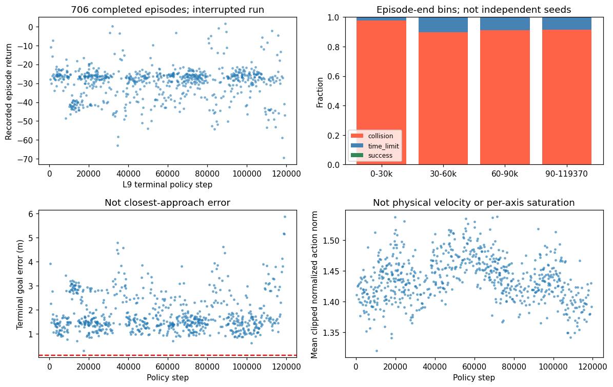
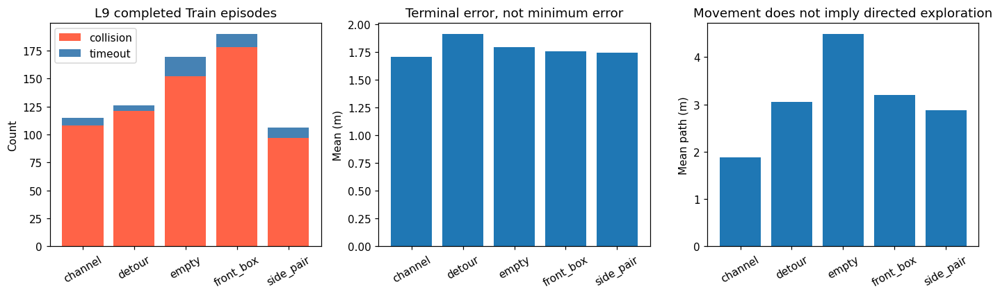
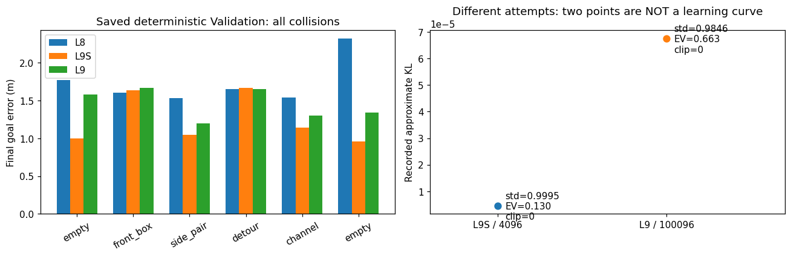

# AUDIT-01：LiDAR-PPO 导航学习失败诊断

## 【1】阶段目标与结论先行

本阶段分析已有L8/L9/L9R/L9S证据，不训练、不开展新的策略性能评估episode或Test场景，仅运行允许的非训练回归。**当前最值得验证的假设，是基础到点与停稳尚未学成，混合场景下成功反馈难以获得；并非已经确认Reward、学习率或LiDAR中的某一项是唯一根因。**

建议下一步先做**空场景优先的课程调度对照Pilot**，不直接重跑百万步。建议申请两臂各65,536步、合计131,072步的新预算；这只是待审批方案，当前仍 `TRAINING_AUTHORIZED=NO`、预算0。原L9永久FAIL；修复链路PASS和本审计PASS都不代表学会避障。

## 【2】背景、实验身份与统计单位

基础提交 `6258dd4ecae09e2614d9c9b47f9eebd52b6b6bee`，分支 `research/lidar-ppo-learning-diagnosis`。已读取总协议、交接、V2协议、项目进度、实验日志及L8/L9/L9R/L9S报告。开始时Git干净、远端SHA一致；原V2 status/recover/doctor通过。

| 历史运行 | 可靠进度/范围 | 完整Train episode | 成功/碰撞/超时 | 保存的独立Validation |
|---|---|---:|---|---|
| L8独立Pilot | 实际8192步 | 46 | 0 / 42 / 4 | 0成功、6碰撞 |
| L9正式尝试，FAIL | 最后资源样本119552步；最后完整episode结束119370步 | 706 | 0 / 656 / 50 | checkpoint100096处0成功、6碰撞 |
| L9R修复 | 离线修复，不训练 | 不新增 | 不把强制故障注入混入自然结果 | 不新增性能评价 |
| L9S独立Pilot | 实际4096步；末尾200步episode未结束 | 21 | 0 / 17 / 4 | 0成功、6碰撞 |

L9的实际异常步、失败transition及具体物理原因未记录，119552不是精确最终训练步数。706条只包括已落盘终止记录，**不能因为其中physical_failure计数0就断言那次未落盘失败不是物理失败**。L9S自然physical/sensor failure均未观察到，不等于百万步稳定性已验证。

以上均是seed0的不同attempt，不是三个独立训练seed。episode是同一策略不断更新过程中的相关样本，不能用706条episode冒充706个seed，也不将三次Validation连成一条学习曲线。未对封存Test进行任何新评价。

## 【3】证据与分析架构

`历史SHA封存文件 → 只读JSON/JSONL解析 → 布局/时间分层 → 源码与数学核对 → 中文报告及图`。

实现：[分析器](../research_regression/navigation_diagnosis.py)、[图表生成器](../research_regression/navigation_diagnosis_plots.py)、[新增测试](../tests/research_ops_v2/test_navigation_diagnosis.py)。不导入PPO策略、张量或优化器，不反序列化checkpoint；checkpoint仅做文件SHA核验。历史完整性另由V2核验，包含模型、原始数据与主工作树87个untracked身份。

先运行V2 prepare生成独立草稿，再由同一公开build_registration API显式继承OPS-02已审查的17项历史测试覆盖；**并非修改旧V1/V2协议**。最终登记清单SHA：`fc712feb312afdb8b8f975724fc74b286b121f7a2adf01caf209702cfd72ef34`；源码身份SHA：`6aacbf7e17024d39dc7eb47da8f602169df469aa9c5ace65da2ca2d048bbf5a5`。新V2执行协议SHA：`fad29c2e86f0a0f0995aceefdaab81aa6483e4ce48bd87d136b05ada592371d3`。

登记前独立只读审查GO后，实际register与登记的offline-audit均PASS。分析器是本轮Level1研发工具：它另获取同一flock，核验AUDIT-01及零预算，只写新目录 `.research_local/audit_01/run_01/`，不把V2固定的报告来源登记任务冒充完整分析执行器。原始SHA在分析前后核对；不存在原实验写入调用。

## 【4】实际结果：先看哪里失败

L9完整episode碰撞率为656/706=92.92%，超时率7.08%，成功率0。末端目标误差均值1.7852m，路径均值3.2226m，净位移均值2.1934m，平均归一化动作范数1.4374；符合历史“净位移<0.10m且路径<0.20m”的无明显运动episode为0。

| L9布局 | 完整episode | 碰撞 | 超时 | 平均末端误差m | 平均路径m |
|---|---:|---:|---:|---:|---:|
| empty | 169 | 152 | 17 | 1.7942 | 4.4950 |
| front_box | 190 | 178 | 12 | 1.7579 | 3.2049 |
| side_pair | 106 | 97 | 9 | 1.7457 | 2.8743 |
| detour | 126 | 121 | 5 | 1.9180 | 3.0579 |
| channel | 115 | 108 | 7 | 1.7081 | 1.8836 |

空场景也0/169，说明不能只怪绕障难度。L9保存的Validation接触证据中，3条撞正X边界墙、3条撞障碍物；两个empty场景均撞正X边界墙。L8相应为2边界/4障碍，L9S为4边界/2障碍。它们说明物体确实运动并发生真实接触，**不能据此重建掠过目标、转弯或制动的时间过程**。训练episode没有接触对，不将Validation接触分布强行外推到656次Train碰撞。

按episode结束步分成 `(0,30000]`、`(30000,60000]`、`(60000,90000]`、`(90000,119370]`：总数216/146/181/163；碰撞211/131/165/149，超时5/15/16/14，成功始终0。平均return分别−29.8292/−30.6566/−28.1478/−29.0491，没有单调的回报或成功改善证据。布局构成与episode长度不同，因此JSON同时保留每个区间内部的布局分层；这些不是固定策略的独立评估。

706条末端误差最小0.28925m，末端<0.1m和<0.25m均0，<0.5m只有1条。**这不等于训练从未接近目标**：没有逐步位置/速度，最小接近距离、是否曾进入目标区、是否曾到障碍侧面均NOT OBSERVABLE。平均路径大于净位移只能说明路径不是直线最短路，不能证明运动随机或完全无目的。

## 【5】Reward：机制已知，因果仍未确认

冻结版本为 `NAV_V2_COLLISION_PREFLIGHT_V1`，真实实现见 [navigation_reward](../mujoco/lidar_integration/navigation_env.py)。每个25Hz策略步：

`r = progress − 0.005||a||² − 0.5 w(d)||v||² + 10 I_success − 30 I_collision − 30 I_physical_failure − 10 I_sensor_failure − 0.01 I_executed − 2 I_timeout`。

其中 `w(d)=clip((0.5−d)/0.4,0,1)`；正常/成功/超时步的progress为 `10(d_prev−d)`，碰撞、物理失败或传感器失败步为0。执行动作项与brake只在实际执行的策略步启用；积分前缺测失败步不执行物理、二者为0。距离单位m，速度m/s，a为已裁到[-1,1]的4D动作；系数是实验奖励权重，不是能量物理单位。没有额外yaw奖励或reward clipping。

成功要求距离<0.10m、速度<0.15m/s连续5个策略step，且无物理失败，属于terminated；碰撞立即terminated。15秒/375step为truncated timeout。接触/物理失败优先，不能同一步同时拿成功bonus。源码中的抑制失败步进度，反驳了“撞墙那一步额外拿进度奖励”的具体猜想，但不能证明整个目标函数不存在更长时域的退化解。

已确认的风险/边界：

- 完整成功bonus在706个已记录episode中一次也没获得，严格停稳反馈稀少是有依据的假设。不能只凭末端数据确定到底卡在接近还是停稳。
- 2条time_limit episode回报为正：step31915为+0.09487，step89133为+1.44327；对应末端误差1.0417m/0.9134m，仍未完成任务。**正Reward不等于成功**；但它们低于不同L5场景中成功Scripted约+25的回报，不能称为已经证实的最优奖励投机。
- 假设机体在远离目标、无碰撞处保持固定位置、零速度、零动作直到超时，则未折扣return为 `375×−0.01−2=−5.75`。这是数学反事实，不是新rollout。它优于已观察碰撞平均−30.3997，提示未来可能存在避碰但不导航的退化吸引；当前无明显运动episode为0，**未观察到已学会悬停**。
- 实际50条timeout平均路径6.1553m、末端误差2.6556m、return−16.1306，不是理想悬停。它们平均净距离进展为负，不支持把超时减少/增加直接当作导航改善。
- 只对没有失败步的timeout，进度项可精确望远镜求和 `10(d0−dT)`，均值−6.30062。由记录的mean action norm及 `0≤||a||≤2`，Jensen给出 `N·mean(||a||)² ≤ Σ||a||² ≤ 2N·mean(||a||)`；其平均动作惩罚界约[−5.31075,−3.76153]。不能将均值平方当成实际动作能量。
- timeout剩余brake只能给保守区间，不能重建逐步brake。部分区间上界>0是信息不足的数学上界，**不是实际正brake奖励**；源码brake始终≤0。碰撞步progress被抑制，碰撞episode不能直接由首末距离重算累计进度。L5保存的碰撞例子中朴素首末推算5.27855、真实分量5.15101，恰好说明该差异；L5三条保存的分量求和与原return一致。

γ=.99对应 `γ^375≈0.02308`；5.12秒rollout内用Value bootstrap，GAE衰减因子γλ=.9405（约0.672秒的几何权重尺度，不是硬截断）。延迟成功/碰撞与绕行短期负进展的信用分配可能困难，**尚未用对照确认**。不据此擅自改gamma或奖励。

## 【6】Observation与动作：合理映射不等于充分可观测

实际CNN：Conv(3→16,k3,s1,p1)→ReLU→Conv(16→32,k3,s2,p1)→ReLU→Flatten2304→FC64→ReLU；与state7、heading2、age1拼成74D；Actor/Critic各64×64，再输出4D高斯动作分布与Value。`normalize_images=False`，不是uint8图像，也不除以255。

LiDAR是局部传感器坐标中24水平×12垂直角度格的最近有效距离与两个Mask；归一化范围0.1–5m，水平15°/格，垂直格覆盖−10°到55°，实际固定模式约−7.21°到52.16°，不是完整球面。range=1同时可能是无回波或未采样，但sampled/hit两个通道明确区分；无回波不编码为零距离障碍。最小距离聚合丢失同格深度分布与更细方位，但没有本次保存的LiDAR张量来量化实际丢失了多少导航信息。

state是 `[target−position_ENU, velocity_ENU, wrap(target_yaw−yaw)]`；另有当前真值 `[sin(yaw_ENU),cos(yaw_ENU)]`，age保持原采样时间，不读取未来。Heading使得**缺少绝对Yaw**不是当前接口的简单缺项。局部雷达与世界ENU速度间在近水平时有已声明的Yaw映射，PI使用真实姿态把世界加速度转为推力，不把动作直接当电机输出。SB3先clip高斯样本至[-1,1]，环境严格检查后缩放为 `[1.5,1.5,1.0]m/s`、1rad/s；RolloutBuffer记录的是未裁剪样本，mean_action_norm则来自实际传给环境的裁剪动作，二者不可混用。

然而策略没有完整Roll/Pitch、角速度、PI积分状态，也没有动作或观测历史。仅Yaw不能恢复一般三维倾斜时的完整传感器旋转；10Hz点云被25Hz策略反复读取且不是逐点运动畸变模型，因此“单帧输入足够Markov”未获证明。这是**Supported hypothesis**，不是已确认主因。旧独立BC在另一个任务的表现不能证明本CNN输入已足够。

L9S保存的4118条因果记录包含4096个step与22个reset，实际81729物理tick；最大age0.098s，未发现未来样本。其日志不含点云、位姿或逐步动作；不能据此为整个L9重建感知质量或所有时效统计。150ms只是当前实验阈值，不是实机安全值。

## 【7】PPO：只有有限快照，不能编造优化趋势

核对已安装SB3 2.9.0的 `ppo/ppo.py::train`、`common/buffers.py::compute_returns_and_advantage`、`common/on_policy_algorithm.py::collect_rollouts`、`common/vec_env/dummy_vec_env.py::step_wait`，而非照搬通用理论。

| 记录值 | L9，step100096 | L9S，step4096 |
|---|---:|---:|
| approx_kl | 0.0000675833 | 0.00000459980 |
| clip_fraction | 0 | 0 |
| value_loss | 27.6652 | 3.32752 |
| explained_variance | 0.662545 | 0.129601 |
| entropy_loss | −5.61310 | −5.67357 |
| mean Gaussian std | 0.984587 | 0.999474 |
| policy_gradient_loss | 0.000424378 | 0.000343915 |

两列来自**不同随机初始化运行（同seed0）**，不是单次训练的前后趋势。L9只有一个可靠诊断点，不能说KL、Value loss或entropy“持续上升/下降”。

源码中GAE用δ=r+γV(next)−V(current)，按γλ递推；Advantage在minibatch内归一化。PPO clip的是新旧策略概率比，不是物理动作或力矩。Value loss为TD(λ)目标的MSE；explained_variance针对rollout中保存的旧Value与returns，不是独立成功预测准确率。entropy_loss是未裁剪高斯熵的负数，不能当成实际安全动作覆盖率。

L9的782个完整rollout、1564个epoch updates、3128次Adam调用在100096里程碑有证据；L9S完整32/64/128并记录Actor/Critic变化、梯度/optimizer有限。**这反驳“完全没有执行优化器”的猜想**，但低KL和零clip_fraction只能提示该点更新幅度温和，不能证明学习率过小、梯度消失或critic整个过程正常。原始Actor均值序列、逐步Value、Advantage、returns和每次更新的诊断没有保留，均NOT OBSERVABLE。

另一个需留意的实现语义是：timeout被DummyVecEnv标记 `TimeLimit.truncated`，SB3在训练用reward上加 `γV(terminal_observation)` 后再算GAE；终止碰撞不走该bootstrap。这是源码确认的行为，训练episode return日志不含这项Value加成。如果15秒本来被当作有限时域最终失败，继续bootstrap和终止惩罚的目标解释需要新协议明确；现有无逐步Value证据，无法量化其影响或确认其导致失败。本轮不改truncation语义。

## 【8】七类原因的证据矩阵

| 原因候选 | 支持/反驳证据 | 当前强度与边界 |
|---|---|---|
| 探索不足 | 从未取得成功反馈；活动路径与近1的高斯std说明并非没有噪声或完全不动 | **Supported hypothesis**：缺少有效的目标到达/停稳经验；是否探索过障碍侧面未知 |
| Reward问题 | 成功反馈严格、近目标brake、折扣/timeout bootstrap；正return也可能失败；理想悬停反事实优于多数碰撞 | **Supported hypothesis**：目标对齐/信用分配风险；未确认奖励投机或唯一因果 |
| 场景难度 | 12场景混合；3个empty也0/169；源码有几何可达性预检 | **Supported hypothesis**：基础任务与多任务难度一起学习；“障碍不可达导致全部失败”无证据；几何可达不等于动力学专家已完成 |
| 观测不足 | 已有heading及Mask，反驳简单缺Yaw/无回波零障碍；缺姿态动态、历史，角度压缩 | **Unresolved / Supported hypothesis**：部分可观测性存在；本次无匹配消融或原始张量 |
| 动作/控制接口 | 已有实际运动、真实接触；历史L5 Scripted在空/通道成功；当前缩放和坐标源码一致 | **Unresolved**：未发现接口符号错误证据；训练期间饱和、各轴输出和高速过冲均未记录，不能宣布全部正常 |
| PPO优化 | 已更新参数；一个L9快照KL小、std仍高，Value解释方差非零 | **Unresolved**：可疑更新强度，不足以归因学习率/epoch/critic；不盲调超参 |
| 环境/终止实现 | L9记账契约确实导致中断；L9R/L9S已独立修复验证；成功需要停稳 | **Confirmed（中断）**，但不能解释此前706条失败的唯一因果；原具体物理触发未记录 |

L5保存的STATE_ONLY_SCRIPTED_NO_LIDAR_INPUT在不同小清单的empty/channel成功，证明存在基本可控的例子，不是L9冻结场景的匹配专家或避障专家；不得以此宣布所有场景/碰撞模型真实可飞。机体碰撞包络仍是TEMPORARY_PLACEHOLDER。

现有12个Train目标Z全部为1m，初始距离约1.889–2.158m，场景数也很少。这是三维物理环境中的有限航点问题，不是已经覆盖矿井三维探索、任意高度目标或真实环境泛化。

## 【9】下一代方案：两个候选，均未授权

### 推荐A：只改变场景调度的基础能力课程对照

**假设**：在成功反馈未出现时，先集中学习到点减速，优于从一开始混合绕障。反证条件：相同预算下课程组依然0成功且没有更低目标误差/更少碰撞；届时不能宣称课程有效，也不自动加预算。

**唯一主要变量**：Train调度。对照组全程均匀12场景；课程组前32768步只均匀抽取原清单3个empty身份，后32768步恢复均匀12场景。不生成新起终点，不修改Yaw/Reward、CNN、动作/物理/PI/扫描频率或PPO超参。两臂均为新随机初始化seed0，初始权重配对相同；独立实验ID与抽样RNG，不从L9/L9S warm start。原空场景已占已结束episode约24%，因此课程并非“从无到有”，而是在有限预算中集中基础学习；不保证能成功。

**预算建议**：65536实际步/臂=512个rollout；两臂共131072步，1个CPU worker，顺序运行。建议每臂wall-time上限3600s，总7200s；MemAvailable<1.5GiB或磁盘<2GiB立即停止，不自动续训或重试。按历史约114步/s粗估约19分钟采样、加初始化/重置/评价约20–30分钟；场景占比改变会改变吞吐，这是估算而非保证。

**评价**：32768和65536固定位置，完整更新后各执行原6个Validation episode；每臂12、两臂24条，Test为0。主指标成功**次数及分场景成功率**，同时报告碰撞/超时/physical/sensor失败、完成时间、路径、末端误差。单seed和6场景不能证明泛化；Final Checkpoint，不以较好的中间点选模型。新的执行授权、场景调度协议、源码hash与资源上限须独立预注册。

**补齐证据**：两臂同样被动记录每rollout PPO诊断、episode Reward分量、最小目标距离、近目标速度/停稳streak、接触类型、动作裁剪比例；少量固定上限轨迹用于解释，但不作为策略输入。相同仪表化先离线验收，不能边训练边改算法。

**可能失败**：3个empty仍含随机初始Yaw及严格停稳，短预算不足；基础技能可能在恢复混合后遗忘；没有解决感知时序、critic或动作探索问题。若课程没改善，先分析证据，不自动延长到百万步。

### 候选B：基本航点BC初始化，再做相同PPO对照

**假设**：成功示范初始化可减少无目的试错。只改变初始化方式；对照从新随机网络开始，实验组仅使用Train中空场景示范做监督初始化，再各65536步PPO。Reward、结构、PPO及场景调度一致；PPO合计131072步，另需单独授权示范采集及有上限的监督预算（例如≤20000个Train状态动作样本、≤2000次监督optimizer更新）。本轮均不执行。

旧BC checkpoint是不同7D输入及归一化，**不能直接把权重加载进新的CNN Actor当作无缝初始化**。应审计输出尺度，用只读教师产生Train基本航点标签，或另行采集可核验示范；现有L5三条记录不是足够的训练数据。State-only教师不是障碍规划专家，不给Student障碍真值。可能复制教师的直冲障碍行为、产生分布偏移，监督和PPO预算还需分开核算。因此优先A，B不是自动后续任务。

不列出“提高碰撞惩罚”“直接调大学习率”等第三个即刻方案：当前没有足够控制证据支持把它们置于前两项之前。不是证明这些方向无用。

## 【10】测试、审查、资源和剩余限制

本轮新增12项纯离线测试RED→GREEN；包含重复JSON键、overflow、输入身份、分层边界、动作能量界、时间因果、单快照解释及PNG元数据序列化。连同原34项V2测试为46 PASS；V1管理49 PASS；相关历史受保护回归885 PASS、15 DESELECTED、2项继承警告。不同套件合计980项唯一通过，0 FAIL、0 SKIP，不是全仓测试。历史回归开启PPO.learn/train及optimizer更新tripwire，实际更新0；测试内部已有受限物理故障注入不作为新训练性能实验或Test场景评价。

分析器本身耗时7.017s、峰值RSS118.30MiB；历史相关回归126.212s、峰值1887.37MiB、采样最低MemAvailable7873.76MiB，未观察到OOM。既有cv2/NumPy ABI、Matplotlib与Gymnasium警告保留，未修改依赖/系统swap。

登记前独立源码/数学/身份审查GO。最终文档、结果及交付复审结论以JSON中绑定证据为准；Git完成必须等待实际Commit/Push/远端SHA核验，公开报告不伪造自身未来commit。没有修改既有训练运行时代码、Reward、模型、checkpoint、旧NPZ或授权账本。

无法观察：L9逐步动作/位姿/速度、Value/Advantage、Reward分量、传感器张量、接近目标与绕障侧向过程、具体失败transition。没有新增轨迹来补救，也不把数学反事实画成真实飞行。本阶段不证明原百万步协议一定失败或一定成功；只是说明不应在信息不足时把重复长跑作为第一选择。

## 【11】给项目负责人的中文总结

现在能确认的是：网络在动，程序确实更新过权重，但连空场景的到点停稳都没稳定学会，不能说已经具备避障能力；原长跑还因另一个已修复的记账Bug提前中断。

最重要的下一步不是堆算法，也不是马上再跑一百万步，而是用较小、预算相同的对照，检查“先学会基础到点，再学障碍”是否有效。建议先批准两组各65536步，共131072步；批准前会再冻结具体执行协议。本轮只是分析，**算法性能没有真实提升**。

当前 `TRAINING_AUTHORIZED=NO`、预算0。没有启动任何新PPO优化器、Pilot、正式训练、Test评价、PX4或真实设备。后续训练必须由项目负责人独立明确授权。
