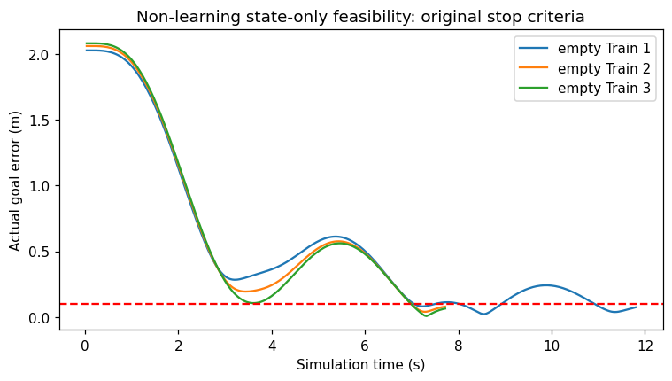
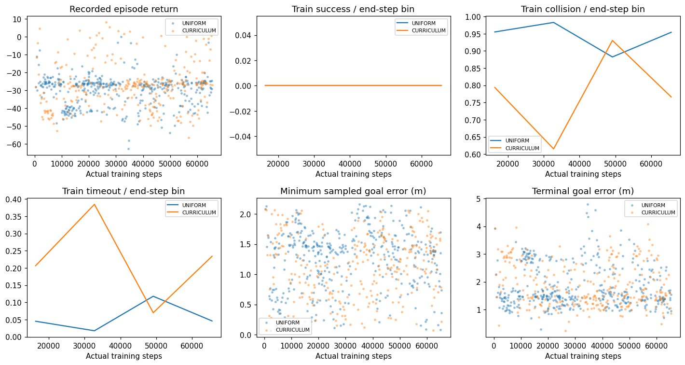
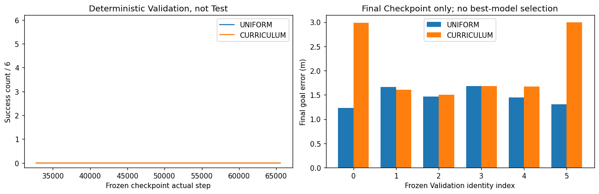
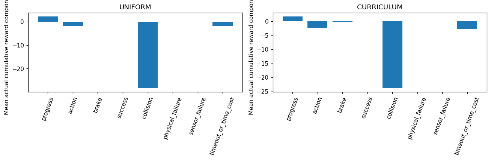
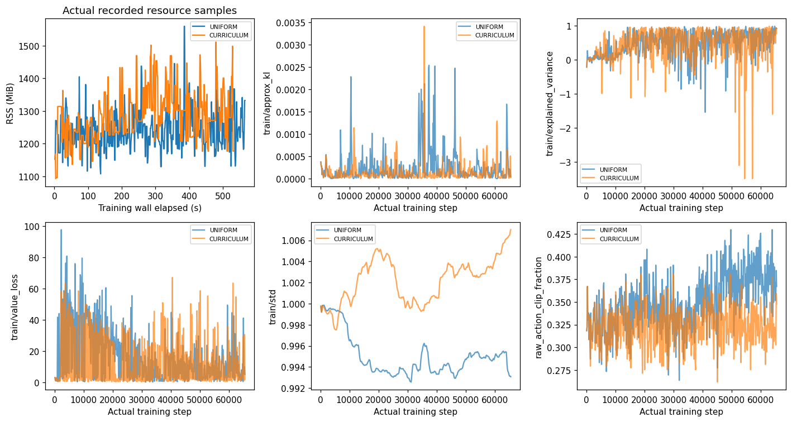

# AUTORL-R1：基础航点课程对照

## 【1】阶段目标

检验“先集中学习到点停稳，后恢复障碍混合”是否优于从一开始均匀混合。先验证三个冻结empty Train的非学习可完成性，再从新随机网络开展两臂各65536步。未以Reward升高代替任务成功。

## 【2】技术背景

AUDIT-01已确认L9的706条结束记录中0成功，empty亦0/169；成功经验不足和任务难度是有支持的假设，不是唯一根因。原L9仍FAIL，不使用其中间checkpoint。AUTORL-01新授权机制已独立审查、测试并提交推送（e9b9019），旧账本和L9Rdenial不改。

## 【3】架构

新独立累计预算→固定主管／进程组守护→原MuJoCo/PI/LiDAR/CNN-PPO→新被动诊断→checkpoint→关闭Train实例→冻结权重的6场景Validation。只使用Train训练，Test为0。

## 【4】实现

复用已冻结`research_regression/authorized_rl/`及历史环境。B课程以已完成策略步32768为阈值，仅在下个自然reset更改抽样集合；不强制截断正在执行的episode、不改变Reward或SB3最后观察。两个运行的初始权重须一致，场景RNG独立但均从seed0开始。代码运行期间不修改。

## 【5】算法与单变量

A全程12Train均匀；B先3empty均匀、后12Train均匀。相同Reward NAV_V2_COLLISION_PREFLIGHT_V1、原CNN/state7/heading2/age1、[-1,1]动作及缩放、PPO128/64/2、lr3e-4、gamma.99、GAE.95、clip.2、ent0、vf.5、grad.5；500/100/25/10Hz及24000射线不变。课程调度是唯一主要干预；被动日志两臂相同，不作为网络输入。

## 【6】冻结协议

公开预注册`autonomous_rl_curriculum_r1_prereg.json`，canonical SHA `889ab050f41aff3b2867e1b4b0d04b4942363ff9499ee2f68c497b0d17f1ba39`。登记SHA `de9a5517c7806fce459411acb9204e010124284d1dd763718e99797684cb7714`；源码SHA `5d969e4ca2758a185e2940522668df57ff0effa194140a27fabc0c63bedef957`。

Seed0、单CPU worker、每臂65536实际训练步（512 rollout），wall上限各3600s。各32768/65536完整optimizer后保存checkpoint；全部训练完成并关闭Train后，分别对各checkpoint做6条Validation，不干扰训练RNG；两臂合计24Validation、Test0，Final Checkpoint不择优。

主要指标为最后6Validation成功数。课程有效的预注册条件：成功数高于A且碰撞数不增加；两臂均0成功不得判有效。所有结果同时报告success/collision/timeout/physical/sensor失败、末端与最小目标距离、路径、return、PPO更新；单seed/小场景不是泛化证明。

## 【7】实际结果

**执行PASS，课程改善假设FAIL，导航能力尚未建立。** 两臂同初始网络SHA，均完整65536步、512rollout、1024个epoch计数、2048次Adam调用；全部梯度／参数有限，四份checkpoint重载权重、optimizer和固定观察预测一致。没有Test、PX4或设备运行。

| 指标 | A：12场景均匀 | B：empty优先课程 |
|---|---:|---:|
| 完整Train episode | 398 | 278 |
| 成功／碰撞／超时 | 0／377／21 | 0／221／57 |
| 物理／传感器失败 | 0／0 | 0／0 |
| episode平均return | −29.9359 | −27.5361 |
| 平均末端目标误差m | 1.7952 | 1.8557 |
| 平均最小采样目标误差m | 1.2534 | 1.1565 |
| 平均路径m | 3.1497 | 4.0729 |
| 进入过0.1m区域的episode | 3 | 1 |
| 无明显运动episode（原阈值） | 0 | 0 |
| 最终Validation成功／碰撞／超时 | 0／6／0 | 0／6／0 |
| 最终Validation平均目标误差m | 1.4655 | 2.0749 |
| 主管实测wall秒 | 586.99 | 546.12 |
| 进程峰值RSS MiB | 1744.47 | 1753.77 |

两臂结束时分别还有144／135个step属于未完成episode，没有把它们编造成失败或成功。B实际在step32919的自然reset切到12场景，不谎称32768就立即更换了尚未结束的episode。A的32768 checkpoint在6Validation均超时，最终全部碰撞；B两次均6碰撞。没有按较好的中间点选择模型。

原Train empty的非学习基线3／3成功：295／193／193步，末端误差.07409／.07958／.06447m；每个最后5帧速度<.15m/s且距离<.1m。这是state-only Scripted，不是PPO或LiDAR避障专家。

原始动力学tick为A1,307,313、B1,308,771（碰撞可在策略周期内提前终止，不伪造为每步都20tick）。总真实训练131072步、4096次Adam，主管实测wall合计1133.10s；预算保守预留7200s，剩余1,868,928步／79,200秒。无OOM或安全停止。当前71项注册标准库回归及6项无学习物理检查PASS；885项历史选择回归继承自相同源码身份e9b9019（15排除），不称本阶段重新跑过全仓。

以机器JSON及绑定原始摘要为准；此文件在训练前建立，不预填成功。基线使用相同冻结起终点及Yaw的state-only Scripted、真实mj_step，最多375步/场景，不是LiDAR策略或运动学回放。必须达到原距离<.10m、速度<.15m/s持续5步标准才放行训练。

## 【8】问题分析

CONFIRMED：课程组平均return更高，但最终成功没有提高，末端误差反而更大；减少碰撞不能单独当成学会导航。两臂都有少数进入目标区域的记录而未成功，说明至少部分episode的问题不仅是从未接近；缺少近目标逐步速度与连续streak，不能把全部失败归因为制动。

CONFIRMED：现有state-only反馈可以完成同一冻结Train empty问题，因此不能说物理任务不可完成。两臂每次rollout均有完整PPO诊断，不再用单快照推趋势：A/B平均原始动作元素裁剪比例34.90%／32.26%，末次Gaussian std为.9931／1.0070；已结束episode平均“任一动作到边界”比例82.29%／78.80%。这两个比例统计单位不同，不相互换算。std接近1的截断高斯本身就会产生大量边界动作，这是已记录现象，不是已经证明的接口Bug。

两臂末次explained_variance都约.92，仍然0成功；Critic能解释失败return不等于Actor已学会任务。KL、Value loss和explained variance有明显波动，不能挑最后一个点宣布整个优化正常或学习率一定错误。

SUSPECTED：有效目标引导／动作探索可能比单纯场景排序更关键。下一优先候选是**解析state-only教师Actor初始化**：先论证原两层Tanh Actor能否在预注册容差内逼近已验证反馈，再只改变Actor初始化；CNN结构、Reward、PPO和默认std不变。Tanh网络一般不能精确等价表示分段线性clip，此能力目前UNVERIFIED，不能悄悄换ReLU或增加跳接。它不是已经训练出的策略，也不是历史BC权重的无缝迁移；不引入障碍真值。先以无optimizer误差测试和初始Validation区分“手写先验能力”与PPO后新增能力，再新实验研究，不能将先验成功冒充学习成功。另一候选是独立改变初始std的对照，暂不同时改动。

CONFIRMED、SUSPECTED与UNVERIFIED将依实际结果区分。任何安全／实现异常保留唯一attempt，不重试，不用增预算或调Reward掩盖。若两臂未改善，下一实验必须基于新的诊断重新预注册。

## 【9】局限

封存清单只有12Train和6Validation，固定高度目标主要是基础局部航点。未验证真实MID360S逐点时间、FAST-LIO2、PX4迁移、真实设备或矿井泛化。旧checkpoint仅身份保护，不载入新训练。长期预算的wall采用全额保守预留，不等于实际消耗。

## 【10】下一动作

本阶段结果／审查／Commit／Push完成后，依据剩余预算和证据选择下一个独立协议。旧授权账本已经初始化，**不得再次initialize**；恢复只审计本地真实事件，未知attempt不重放。出现SYNC_PENDING先同步，不启动新研究训练。

## 【11】给项目负责人的总结

这次只问一个可反驳的问题：先把最基本的到点与停车练好，能否帮助后续避障？两组用相同网络和预算，真实碰撞与停稳结果不会被回报曲线替代。结果为失败也会保留；不会为了花完200万步而重复无效训练。
