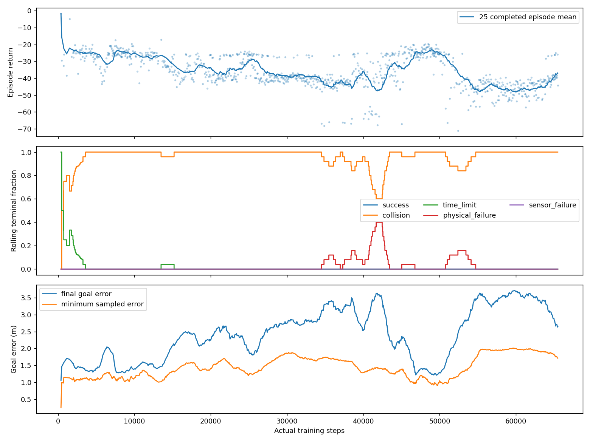
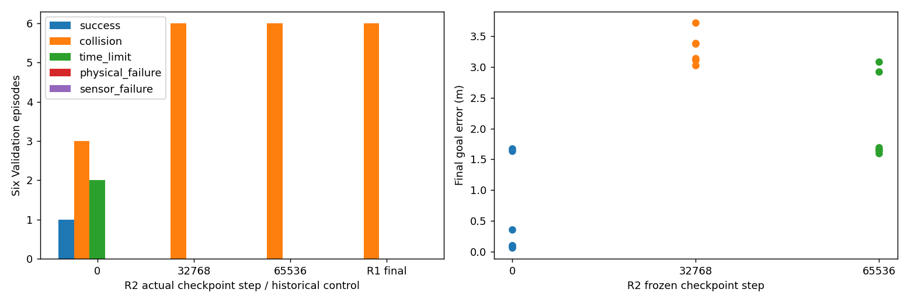
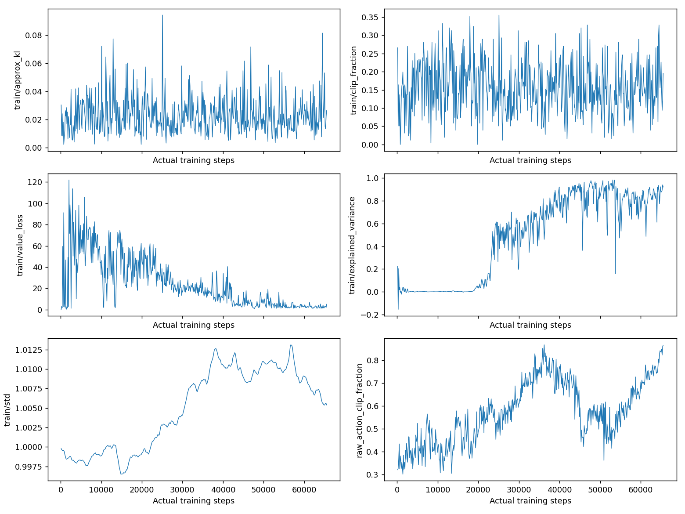
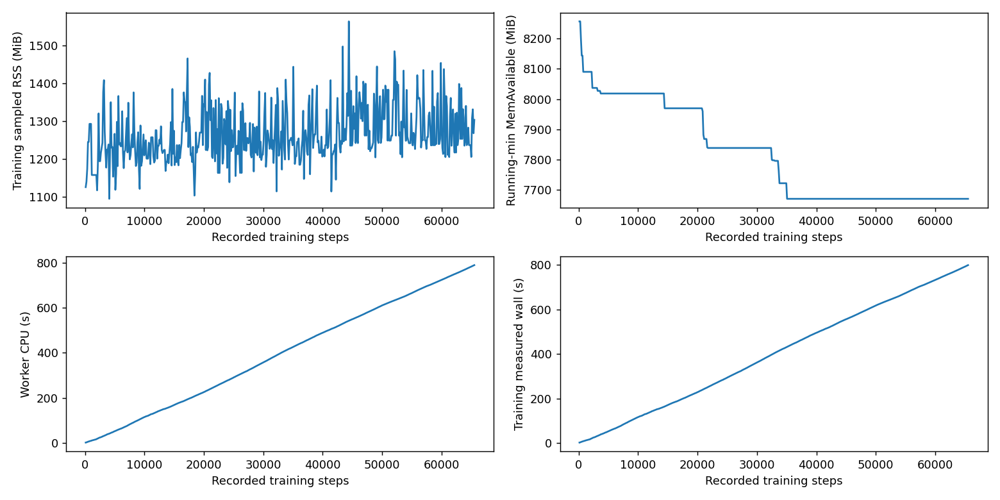
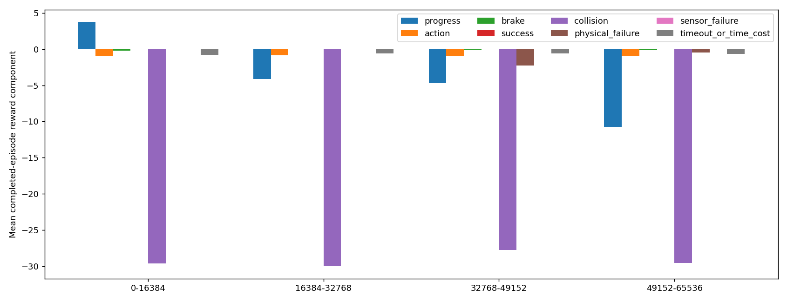

# AUTORL-R2：解析Actor初始化的单变量PPO实验

## 【1】阶段目标

研究基本目标反馈初始化能否改善PPO，而不是重复失败的课程或直接重跑百万步。对手写先验、PPO新增能力和LiDAR避障保持不同结论。

## 【2】技术背景

R1均匀及empty优先课程最终都是0/6成功。先前独立预检已证明原结构经解析初始化后可在3个冻结Train empty按原标准停稳；该能力是手写先验，不是学习。预检已推送`161997c0cecbe0b0f1e19d861d927ab774bb7ccf`。

## 【3】架构

同一不可重置累计授权→新固定schema2执行profile→原监督器／独立进程守护→原多场景MuJoCo/PI/LiDAR/CNN-PPO→step0／32768／65536 checkpoint→关闭Train→各6Validation。Test=0，无PX4或设备通信。

## 【4】实现

`prior_profile.py`只允许固定ARL_R2_PRIOR_SEED0和65536步／3600s；核验已发布预检／原始证明、原R1控制摘要与底层源码。`budget.py`增加schema2验证，保留原schema1与原grant身份／事件链，不能增加总预算。CLI显式prepare-prior/start-prior，无checkpoint或任意脚本参数。

`prior_training.py`先核验全新seed0随机网络与R1相同，再调用原解析初始化；一次正常reset后设置SB3原_last_obs／episode-start标志，保存step0，不额外抽样或优化。worker其他训练逻辑继续复用原实现，仅对新profile增加初始化及step0事件；1536MiB MemAvailable／2GiB磁盘保护、单worker、失败不重试、RESTART_REQUIRED保留。

## 【5】算法与控制

只改变Actor初始均值权重。原CNN、Critic随机初始、log_std=0（std=1）、NAV_V2_COLLISION_PREFLIGHT_V1、PPO128/64/2、lr3e-4、gamma.99、GAE.95、clip.2、ent0/vf.5/grad.5均不变。500/100/25/10Hz，24000射线；原4D归一化动作及[1.5,1.5,1.0]m/s、1rad/s缩放不变。没有动力学或PID修改。

初始均值近似clip([ex/4.5,ey/4.5,ez/3,yaw_error])，原Tanh网络全域裁剪动作误差上界.016315；CNN／Critic／std不赋值。初始不依赖LiDAR，后续学到避障仍需独立证据。

## 【6】冻结协议

登记SHA`520b6dfd65c796efe67f15e2eb2799908ae1e45b4b7f648902a049d4ee638757`；源码`44bd92f55daabbda4ce21b07a6563b27d2ed0cec9cb395a250cbe65f6179ca1e`；预注册canonical SHA`7755b3b7bd7efe20f0c23710e1833751e2a23f1527ec253a90c8f3c75697fb8f`；执行协议`09a4da2c329ddcf6dc6da79dfa4c49c0bac6eab441e53f6c99e2a6040566f61e`。

seed0、CPU单worker、实际65536步／3600s cap。12冻结Train均匀；只用已冻结的R1 UNIFORM作为**历史控制**，不重复旧ID、不声称同时执行新对照。3份checkpoint在Train关闭后各自执行6Validation，共18，Test0。Final Checkpoint，不择优。

事前指标：最终成功数高于R1且碰撞不增加，才支持此单seed初始化效果；最终成功数高于自身step0且碰撞不增加，才支持PPO超越先验。候选基础导航门：至少4/6成功、至多1/6碰撞、物理／传感器失败0；这不证明多seed、LiDAR依赖或矿井泛化。完整定义见[设计及实施计划](AUTORL_R2_TRAINING_DESIGN.md)与冻结JSON。

## 【7】实际结果

**工程执行PASS，初始化效果FAIL、PPO超越先验FAIL、候选基础导航准入FAIL。** 唯一attempt完整65536步、512个rollout、1024个epoch计数、2048次Adam调用；参数／梯度有限，三份checkpoint的权重／optimizer／固定观察预测重载一致。原R1/L9未重复、未续训；Test=0。

| 指标 | R2实际结果 |
|---|---:|
| 完整Train episode | 983 |
| 成功／碰撞／超时 | 0／956／3 |
| 物理／传感器失败 | 24／0 |
| 平均episode return | −35.9123 |
| 平均末端／最小采样目标误差m | 2.4720／1.4809 |
| 平均路径m | 3.1870 |
| episode平均动作范数 | 1.6789 |
| episode平均“任一动作到边界”比例 | 96.33% |
| 曾进入.1m区域／无明显运动episode | 1／0 |
| 主管实际wall | 814.918s |
| 训练实际物理tick | 1,301,270 |

最后55步属于未完成episode，计入65536但不编造成终止结果。24次物理失败全部为自然`outside_flight_area`，未进行故障注入；规范class和原始reason同时保留，旧invalid-outcome记账异常未复发。碰撞有真实MuJoCo接触对，机体仍是TEMPORARY_PLACEHOLDER粗略碰撞体，不是实机碰撞安全认证。

| 独立Validation（每次6场景） | 成功 | 碰撞 | 超时 | 物理／传感器失败 |
|---|---:|---:|---:|---:|
| step0：手写先验，未学习 | 1 | 3 | 2 | 0／0 |
| step32768 | 0 | 6 | 0 | 0／0 |
| step65536：固定Final | 0 | 6 | 0 | 0／0 |
| R1 UNIFORM历史Final | 0 | 6 | 0 | 0／0 |

最终没有胜过历史随机初始化，也没保住自身先验；没有使用初始或中间checkpoint冒充最终结果。全部Train身份及均匀抽样序列前缀与R1相符，未因step0额外抽场景。初始完整随机policy为bc1adbd1…，赋值后1f3e9a0a…，原Critic初始c8eb88d0…与R1相同。运行摘要SHA `03fdb73a394880432eabbe19b7e28ce0325186e8d96d9346aae1dd319ec3d928`；ZIP与原始文件local-only，完整SHA／大小见JSON。

实测训练采样峰值RSS1703.41MiB；晚启动的独立/proc观察器4547个样本，其内核HWM最大同为1703.41MiB，最低观测MemAvailable7551.71MiB。它不是完整全时段峰值证明，最终退出后精确HWM未核验。主管wall与worker记录813.545s分开，最后CPU采样804.65s，未观测OOM（本次boot的oom_kill=0）。旁路观察器首版对合法空/proc字段解析失败，原空log保留；根因复现后仅修正外部观察，不修改冻结训练代码，原强制资源／生命周期守护始终工作。

最终源码78项OPS、9项真实张量／MuJoCo快照及885项历史选择回归完整PASS，合计972个不同测试、15项明确排除；非全仓。运行后另做78项标准库复核，不重复计数。准入检查optimizer0；实际训练2048调用均已计预算。独立训练前GO与结果复审见机器报告，远端完成以OPS收据为准。

2026-10-16恢复：已核验实际源码与_02登记一致，78项OPS、9项Tensor结果完整；最后历史回归因机器重启缺少final.json，标INCOMPLETE（不计PASS），保留原部分stdout，仅补做该无更新测试。R2没有预留／attempt，累计余额仍1,868,928步／79,200s。旧OPS源码不匹配拒绝是版本升级保护，不绕过；新登记后才能执行。

恢复链随后完整通过：历史回归重新完整执行885 PASS／15 DESELECTED／2既有警告，129.33s、RSS1949.30MiB；新准入收据dfe21c6c…核验，V2新登记、recover/doctor PASS，唯一R2预留并启动。预留后预算余额1,803,392步／75,600s，尚不代表65536训练步已经完成。

## 【8】问题分析

CONFIRMED：R2没有改善最终导航，先验Validation能力反而下降。Train持续实际运动、无明显运动episode为0，不能归因为“已经学会悬停”。合法物理失败得到正常统计，工程稳定与算法失败是不同结论。

CONFIRMED：512个rollout平均raw动作元素裁剪57.37%、最后86.52%；episode平均任一动作触边96.33%是另一统计单位，不能混用。Gaussian std末次1.0054，仍约1；平均approx_kl=.02320、最大.09420，明显高于R1 UNIFORM平均.000247。KL是诊断，不是已违反某个未设置的target_kl安全阈值。末次explained_variance=.9211，而仍0成功；Critic拟合失败return不代表Actor学会任务。

SUSPECTED：默认探索尺度与动作裁剪、解析初始化参数尺度导致的函数空间更新敏感性均值得分离；较大KL不证明唯一原因就是学习率或std。不能把全部失败简单归为Reward，也不调整本次任何参数。

下一优先是**只改变初始Gaussian std**的对照：先回到原随机Actor，std1对照已有R1，另可在解析Actor上对照R2，组成可解释的2×2因素证据。候选std=.3；各65536步只是后续独立预注册提案，须新源码／测试／审查与同一累计预算预留。CNN、Reward、PPO学习率及其他超参数不同时改变。若有提升，仍需区分先验能力和训练增益，并另做LiDAR依赖检验。

## 【9】局限

一个seed、12/6小清单、历史控制的跨阶段管理代码差异；所有底层算法及原运行源码必须相同。初始先验忽略LiDAR；优于随机初始化不自动代表避障学习。没有Test、PX4、FAST-LIO2或真实设备。可选cv2/NumPy ABI警告保留，不修改历史解释器。

仅保存前几个episode的bounded逐步trace，并非全部65536步的LiDAR时间序列审计；时序正确性有源码及回归支持，不伪称逐步运行证据齐全。没有验证百万步内存稳定性、EXACT_RESUME或BOUNDARY_RESUME。训练结束保守余额为1,803,392步／75,600s；主管实测wall不会自动退还全额3600s预留。

## 【10】下一阶段

本次完成独立结果复审、Commit/Push和远端核验后，按上述单变量std方案设计下一阶段；不得重新start此ID、延长65536预算或改Reward。仍在总授权内，普通阶段无须用户逐次确认，但新协议／准入不能省略。剩余预算必须读取独立账本，不能从公开MD恢复授权。

## 【11】给项目负责人的总结

本轮给网络写入了基本到点规则，但PPO没有保住它：训练前1/6成功，最终0/6。代码和记账链跑完了，不等于算法变好了。旧L9失败不会被覆盖，也不会为追求好看结果重跑本次。下一步只分离探索噪声这个变量，保留奖励／网络等；所有新训练继续受你批准的剩余预算约束，不接PX4，也不拿Test调参。
