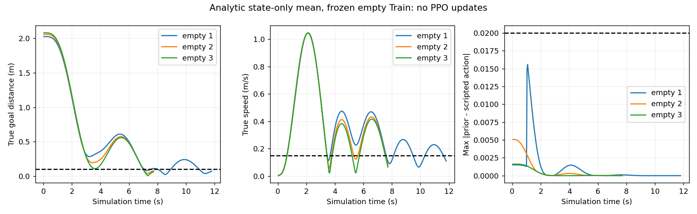

# AUTORL-R2-PREFLIGHT：基本目标反馈的Actor表达能力

## 【1】阶段目标

只检验一个问题：原有两层Tanh Actor在不改变结构、不调用optimizer的情况下，能否近似已验证的state-only反馈并完成冻结empty任务。不是新的PPO训练，不声称学会避障。

## 【2】技术背景

R1的课程和均匀两臂各65536步均完整，但最终Validation都是0/6成功。仅改变课程未改善预注册指标。三个相同empty Train的原Scripted基线却可以停稳，因此先研究基本目标引导的可表达性。R1已Commit/Push远端核验`9d3ac31e401e5b05b124c220958d3573c93c5763`。

## 【3】系统架构

原500Hz MuJoCo／100Hz PI／25Hz策略／10Hz 24000射线→原Dict输入／CNN→原Tanh Actor（解析初始化均值）→原动作缩放→真实物理步进。状态标记SIM_GROUND_TRUTH_STATE；LiDAR仍实际扫描，但初始Actor均值故意不依赖它。没有地图、未来观测、Validation或Test。

## 【4】代码实现

新增`research_regression/authorized_rl/actor_prior.py`、`prior_tests.py`和`prior_preflight.py`。只改变Actor第一、第二层权重的前四行及action head；未使用的隐藏单元保留原随机权重，CNN、Critic、log_std不变。加载旧模型和训练worker均未改变。

preflight入口固定三条empty Train，拒绝已有目录；在创建attempt之前确认独立进程组，获取共享OPS flock，核验登记与历史身份，独立进程守护总wall120s／内存1.5GiB／磁盘2GiB。每步检查资源和停止请求。PPO.learn/train与Adam.step为禁止调用tripwire；不保存可供训练初始化的checkpoint。

## 【5】数学原理

Scripted归一化反馈为clip([ex/4.5,ey/4.5,ez/3,yaw_error],−1,1)。使用原features74中的state索引64、65、66、70。

令未裁剪反馈为y，前四条路径实现：

`f(y)=10*tanh(0.5*tanh(0.2*y))`。

f是奇函数、单调且0≤f′≤1。对0≤y≤1，y−f(y)单调不减，最大值1−f(1)=0.0163147808264；y≥1时clip(f(y))的误差不会更大，负半轴由奇对称得到。因此事前固定动作最大误差≤0.02，**不是精确等价**，也没有把Tanh换成ReLU。这里只改变确定性均值；Gaussian std仍1，随机探索行为并不等价于Scripted。

## 【6】实验协议与身份

独立阶段分支`research/lidar-actor-prior-preflight`，基线9d3ac31；登记SHA `443833a087946a174ef3988c8e7f260ae6ea6d3cd1e8ec80bd12693f020698b0`，源码SHA `400e25a68a2af0ed3dcf351ed7deeca657d9bc7d78f6f9b7f92ee8ec831d699d`。设计和实施顺序见[AUTORL_R2_PRIOR_DESIGN](AUTORL_R2_PRIOR_DESIGN.md)。

Seed0全新初始化，不读任何历史checkpoint；赋值前完整policy SHA与R1精确相同`bc1adbd197b52b4bfd0bb759a749c16e351092960557f2d341ba3321876b39ba`。赋值后SHA `1f3e9a0a6779d9b7290ba138bda5e6f916e5d73380b291cc9a97d1650c5e835c`。

每条最多375策略步，成功标准保持距离<.10m、真实速度<.15m/s连续5步，无碰撞或安全失败。训练／Validation／Test episode为0；此处3条是Train身份的无学习物理probe。唯一输出`.research_local/autorl_r2_prior/run_01/`，原始轨迹local-only。

## 【7】真实结果

**解析近似PASS，空场景物理验证PASS；PPO学习和避障能力NOT TESTED。**

| 冻结empty Train | 策略步 | 最终距离m | 最终速度m/s | 最大动作误差 |
|---|---:|---:|---:|---:|
| 0f905943… | 295 | .072885 | .109081 | .015570 |
| 9cac892b… | 193 | .077863 | .077572 | .005070 |
| adeeeb0d… | 193 | .062842 | .065582 | .001617 |

三条最后5帧均满足原距离／速度条件，每步真实推进.04s，无qpos回放。观测动作差最大.015570<.02。模型赋值后、全部物理probe结束的权重相同，optimizer空，训练步0。实际probe wall6.5034s，峰值RSS1518.10MiB，最低MemAvailable6855.20MiB；无OOM。

6项显式真实SB3无optimizer测试GREEN；缺失初始化先RED，启动隔离检查亦有RED→GREEN。71项OPS回归及本阶段重新执行的885项相关历史回归PASS，15项明确排除、2项既有警告，合计962项测试（另有3条物理probe），不是全仓测试。历史回归129.00s、峰值RSS1880.04MiB、最低MemAvailable6241.98MiB，禁止optimizer调用0；未访问旧/tmp依赖。独立源码预审GO、Critical/Important/Minor均0；结果复审与远端完成状态以机器报告及OPS收据为准。

## 【8】问题分析

CONFIRMED：原结构能表达有用的基本到点先验；未训练的解析Actor已经能完成相同空场景。不能把原PPO0成功简单归因为网络无法表达这种控制律。

CONFIRMED：图中存在明显往返／减速过程，并非完美控制；只在冻结三场景按原标准停稳。该先验不感知障碍，不能认为绕障成功。std=1仍存在，后续随机探索可能破坏先验能力。

SUSPECTED：给Actor合理的初始均值可能改善成功经验稀缺问题；也可能被PPO更新遗忘。尚未训练，不能提前判定哪个结果发生。

UNVERIFIED：加入先验后是否能在新的障碍上学到LiDAR依赖的决策，是否优于原随机初始化，是否具有多seed稳健性。

## 【9】局限

无PPO optimizer更新；只验证确定性均值。没有Validation／Test结果，不外推避障或矿井泛化。没有PX4、FAST-LIO2、真实设备；cv2/NumPy可选Atari导入ABI警告及Matplotlib Axes3D警告保留，当前CPU链路真实可执行，未改依赖。

独立累计授权账本前后完全相同：训练已预留131072步／7200s，剩余1,868,928步／79,200s；没有修改旧V1/V2账本或L9R denial。当前原训练CLI仍只支持已完成R1，不能拿本报告直接启动R2训练。

## 【10】下一阶段

本阶段完成复审和推送后，为R2建立独立初始化实验协议和显式入口，复用原固定监督执行器与累计预算。候选预算65536步、seed0、单CPU；只改变Actor初始化，CNN、Reward、PPO、std、场景清单均不变。应先冻结初始Validation和最终Validation的比较口径，以区分手写先验与训练后增益；不得复用R1 attempt或偷偷重跑对照。实现未通过测试／独立GO前不训练。

## 【11】给项目负责人的总结

这次没有再花训练步数，而是检查网络是否至少能装下一个可靠的“朝目标慢下来”规则。答案是可以，三个空场景都按旧标准停住了。但这来自手写初始化，不是神经网络自己学会，也完全不等于会绕障。下一次用独立、较小训练对照看它能否带来真实学习收益；仍在已批准预算内，不需要你逐阶段管理，不能自动扩大预算或接PX4。
