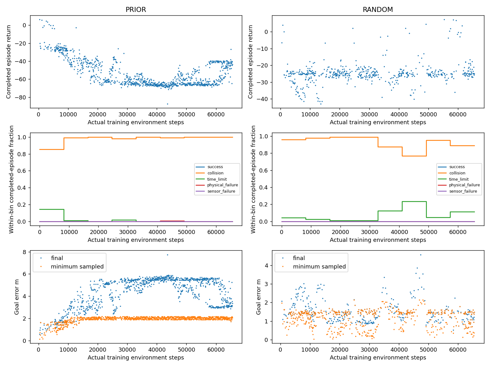
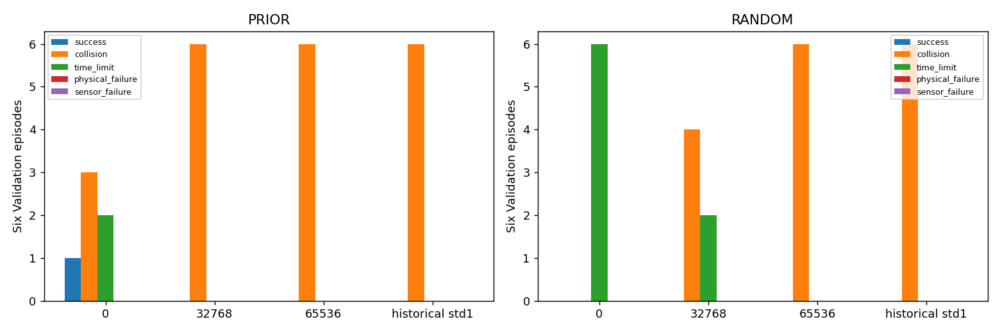
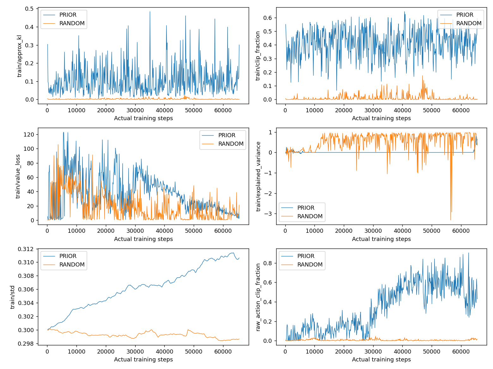
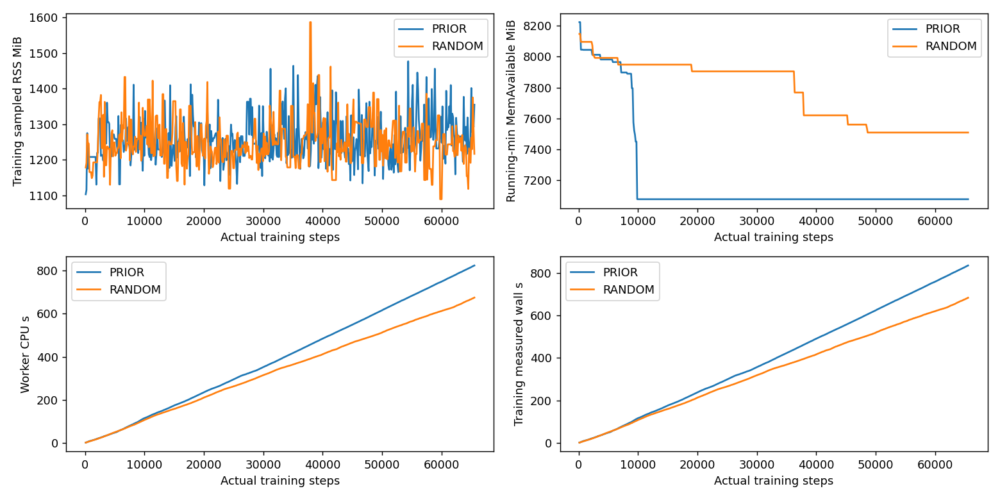
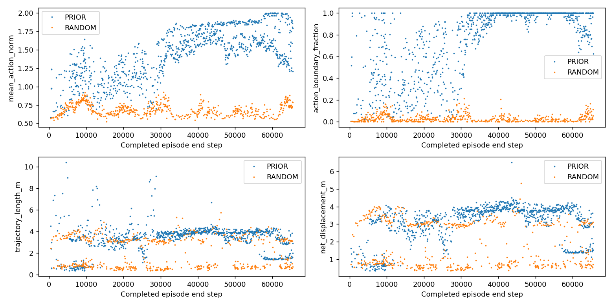

# AUTORL-R3：初始动作探索尺度对照

## 【1】目标

在保持原Reward、网络、PPO及动力学不变时，研究初始Gaussian std从1降至.3是否改善基础导航学习。不是直接重跑原失败百万步，不承诺成功。

## 【2】背景

R1随机初始化与R2解析初始化在std1下最终均0/6成功。R2本身的手写先验在step0为1成功／3碰撞／2超时，训练后能力丢失；raw动作元素平均裁剪57.37%、末次86.52%，而std仍约1。较大KL也可能来自解析网络尺度，不能把噪声当作已确认唯一根因。

R2已在`669afdcfa0551496bc9e8262f5c2d7353a5828d7`推送且远端核验，最终独立复审GO、三个科学标准FAIL，不重复其attempt。

## 【3】架构

同一累计授权账本→固定schema3新profile→原single-worker监督／资源守护→12Train真实MuJoCo/PI/LiDAR/CNN-PPO→0／32768／65536冻结checkpoint→关闭Train后各6Validation。两个新臂顺序执行，不同时常驻两个MuJoCo。Test封存。

## 【4】代码实现

新增`std_profile.py`固定RANDOM／PRIOR两个ID、std.3、每臂65536步／3600s；重用历史物理可完成性及R1/R2摘要身份验证。`std_training.py`只接受全新seed0未reset网络，声明均值初始化后只赋值`log_std=log(.3)`，保留可训练性；一次正常reset后保存评估专用step0。旧schema1/2及grant未改，CLI／runtime／worker仅增加显式schema3分支，不接受任意脚本或checkpoint。

## 【5】算法原理

PPO原Gaussian动作在归一化空间采样，再由原环境裁剪缩放；std不是m/s。零均值一维越界概率为`erfc(1/(sqrt(2)*std))`，std1约.31731，std.3约.000858。非零均值及学习过程中不能用此数代替实际裁剪比例。std仍由原PPO优化，没有固定方差、改变entropy或学习率。

原CNN、Tanh64×64 Actor/Critic、128rollout／64batch／2epochs、lr3e-4、gamma.99、GAE.95、clip.2、ent0/vf.5/grad.5、NAV_V2_COLLISION_PREFLIGHT_V1均不变。500/100/25/10Hz、24000射线，4D动作与原速度缩放不变。初始化先验最初不读LiDAR，不能把其能力说成学习。

## 【6】冻结实验协议

两个唯一ID：`ARL_R3_RANDOM_STD03_SEED0`、`ARL_R3_PRIOR_STD03_SEED0`。每组新随机seed0，不加载任何旧权重；PRIOR仅调用原解析初始化。CPU、worker1，各65536实际步／3600s cap。原12Train均匀抽样；每组3份checkpoint各6Validation，Final选择，Test0，RESTART_REQUIRED。

RANDOM对照已完成R1 UNIFORM/std1，PRIOR对照已完成R2/std1。各自最终成功更多、碰撞不增加才支持初始std效果；与自身step0比较另行判断学习增益。基本候选仍至少4/6成功、最多1/6碰撞、物理／传感器失败0。跨阶段历史对照、小Validation及单seed不支持统计显著或泛化结论。SHA以预注册JSON和真实登记为准，不由文档恢复授权。

## 【7】实际结果

**工程执行PASS；两臂初始std改善、超越step0、基本导航候选三项标准均FAIL。** 两个唯一attempt各完整65536步、512rollout、1024epoch计数、2048次Adam调用；共131072真实训练步、4096 Adam调用，均已计入同一累计预算。两组所有参数／梯度有限，三份checkpoint权重／optimizer／固定观察预测重载一致；不从旧模型恢复，Test0。

| 完整Train指标 | RANDOM/std.3 | PRIOR/std.3 |
|---|---:|---:|
| 结束episode | 548 | 971 |
| 成功／碰撞／超时 | 0／513／35 | 0／956／14 |
| 物理／传感器失败 | 0／0 | 1／0 |
| 未完成尾段步数 | 65 | 4 |
| 平均return | −24.72895 | −53.28667 |
| 平均末端目标误差m | 1.47903 | 4.29163 |
| 平均最小采样目标误差m | 1.14094 | 1.92191 |
| 平均路径m | 1.99461 | 3.37425 |
| 曾进入.1m区域episode | 3 | 0 |
| 无明显运动episode | 0 | 0 |
| 实际物理ticks | 1,306,004 | 1,301,650 |
| 主管实际wall s | 713.32048 | 851.68841 |
| worker ru_maxrss峰值MiB（含checkpoint／Validation） | 1679.71 | 1779.86 |
| 训练资源采样中的ru_maxrss最大值MiB | 1644.84 | 1699.07 |
| 训练瞬时RSS样本最大值MiB | 1587.03 | 1476.82 |
| 训练最低观测MemAvailable MiB | 7508.36 | 7076.81 |

尾段未完成，计入预算但不伪造成terminal结果。PRIOR唯一自然物理失败是第43635步`outside_flight_area`，不是故障注入，也不是整个attempt异常。碰撞来自MuJoCo实际接触；接触对出现次数可能多于collision episode数，不混为同一计数。粗略机体碰撞体仍为TEMPORARY_PLACEHOLDER。

| 各6场景独立Validation | RANDOM 成功／碰撞／超时 | PRIOR 成功／碰撞／超时 |
|---|---:|---:|
| step0，未学习 | 0／0／6 | 1／3／2 |
| step32768 | 0／4／2 | 0／6／0 |
| step65536，固定Final | 0／6／0 | 0／6／0 |
| 各自std1历史Final | 0／6／0 | 0／6／0 |

本阶段36次Validation，物理／传感器失败均0，没有Test。PRIOR step0确定性聚合结果与R2/std1 step0精确相同，符合只改std而不改均值；该1次成功始终是手写先验，不算PPO学习。最终不胜历史控制，也没超越自身step0，没有按中间4碰撞2超时择优。

6项新标准库profile及4项真实初始化测试已RED→GREEN；最终84 OPS＋13 Tensor＋885历史选择回归完整PASS，共982个不同测试、15排除，均无optimizer。历史回归124.136s、RSS1914.28MiB，有两项既有warning；原cv2 ABI stderr另行保留。运行后另做84项OPS复核，不重复计新增。独立源码及实际准入复核GO、Critical/Important0；最终结果复审和发布见JSON及真实V2收据，不能用运行前GO代替。

登记SHA`955dd536d1c50c64c9a7f02cc2b8a575acbdb0aa5254680fe6c4dffd5fa9ab5e`；源码`b7290417a340087c30b1bd77bde87f4b9cc7a89c09ecf2fe44afa70de7a3b8b1`；预注册`f71199eec74dbf6d753babf2b4da28b20ead499147f4157e34301e5fd498ebdb`；准入`498ecfd9ec4320c98b29156bd7f95f5b0397a37998c6afb1a2c8c8c11cd35a3b`。运行源码前后未变，RANDOM／PRIOR summary SHA分别`7651327c99f27940ce047d4b03b57b40f4ab59aff37632757ae70350445d36d1`／`afbeac0d092aa4f38c318f4b75909006db65f2f8eaa4435783ae6b7a887ada4e`；完整ZIP身份和原始文件清单见JSON，均local-only。

## 【8】问题分析

CONFIRMED：两臂都没有最终导航改善。RANDOM全512rollout平均raw动作元素越界仅0.62485%，但仍最终6碰撞；因此减少裁剪并不足以解决问题。PRIOR该比例33.902%，比std1 R2的57.37%低，但目标末端平均误差更大、先验能力仍丢失。episode平均“任一动作触边”分别3.389%／77.786%，统计单位不同，不能混用。

CONFIRMED：RANDOM平均approx_kl=.002566、最大.024156；PRIOR平均.105443、最大.483689、最终.300467，分别与其历史控制比较。更小std在固定学习率下也改变函数空间KL尺度，不是纯粹降低物理噪声；解析Actor参数化的优化敏感性值得独立研究。没有设置target_kl限值，不能把上述诊断直接写成安全阈值违规或唯一根因。

SUSPECTED：目标反馈／近目标减速被更新破坏、成功反馈稀缺及长时信用分配，比继续盲目减小std更值得区分。原GAE衰减因子gamma*lambda=.9405，权重的几何尺度约16.8个策略步（.672s），这不是“超过该时长没有梯度”的硬截断，也不证明它导致失败。UNVERIFIED：具体根因、多seed与LiDAR依赖，不能用一次失败证明PPO永远学不会。

## 【9】局限

历史控制管理代码版本不同，底层算法／物理已通过身份校验。固定12/6/6规模小，不读取Test。无PX4或实机；真实MID360S逐点时序未建模。原cv2/NumPy可选Atari导入ABI警告保留，CPU训练链不用cv2、不升级依赖。没有百万步内存或精确恢复保证。summary.rss_peak_mib是checkpoint重载／Validation之后查询worker的ru_maxrss，包含这些阶段；训练资源样本的历史峰值及瞬时RSS分别列出，不能混用，也不是退出之后的最终精确HWM。MemAvailable曲线是累计最小值，不是瞬时空闲量。未观察OOM，本次boot的oom_kill=0。

资源口径补注：旧R2使用同一动态ru_maxrss属性，其summary的1703.41MiB也应解释为包含重载／Validation的worker历史峰值，而非只发生在训练采样窗口；此处澄清标签，不改旧原始数据、数值或科学结论。

当前累计327680训练步／18000s保守wall预留，余额1,672,320步／68,400s；本阶段主管实际wall合计1565.009s，两者不得混为实际消耗。全部5个attempt均COMPLETE，不退款或刷新账本。历史模型、L9 FAIL、旧零授权和87项untracked不改。

## 【10】下一阶段

完成当前结果独立复审、Commit/Push远端核验后，优先做无optimizer的冻结checkpoint反馈诊断：在明确标记的受控观察上检查目标误差／速度变化如何影响动作，区分状态反馈与裁剪／更新效应。该输入探针不是闭环任务成功率，也不能复用Test或未来状态。依据证据再设计近距离到点课程或其他单变量方案；不重复本两臂，不直接增加百万步。

## 【11】给项目负责人的总结

这次真实训练了两个65536步新对照，缩小随机动作幅度仍没让网络学会到点停稳。程序完整运行了，算法改善没有通过，阴性结果会保留而不是改口径。下一步先检查训练后“看到目标和自身速度时究竟会发什么指令”，再决定新的单变量训练，不盲目重跑；预算仍充足，无需你逐阶段确认，也不会扩大授权或连接PX4。
