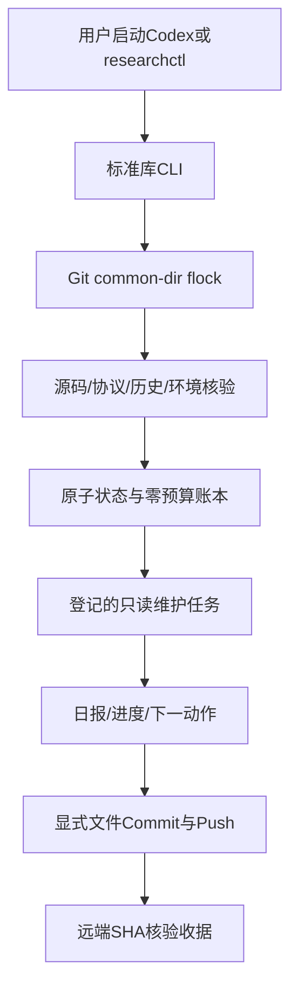

# Phase OPS-01 — Research Operations and Persistence

## 【1】阶段目标

建立每日重启后可恢复的研究管理入口、状态、独占锁、预算、停止与GitHub同步。OPS-01只使用Level0/1；新PPO更新、Pilot、正式训练、PX4及真实设备次数均为0。

## 【2】技术背景

历史L9因终止记账契约失败；L9R修复后，前一会话已经完成并推送L9S4096步链路验证。总协议所列77e921f是历史基线，实际开始HEAD984a1fd是它的直接后继，已核对远端，未回退或重跑。L9仍永久FAIL，L9R的formal_retrain_authorized=false未改。当前新增训练预算为0；接口可运行不能解释为学会避障。

## 【3】系统架构

状态和原始证据在Git忽略的.research_local；公开摘要仅供阅读，不能恢复权限。没有训练执行器、任意shell执行器、开机服务或后台AI。

## 【4】代码实现

`researchctl`调用`research_ops/cli.py`。`storage.py`负责严格JSON、fsync原子发布、exclusive attempt和真实flock；`identity.py`流式核对文件/源码及旧L9；`environment.py`检查真实Python/API、固定上游及资源；`lifecycle.py`实现前台任务、停止、异常恢复；`documents.py`生成公开交接与11节阶段文档；`synchronization.py`检查完整待发布历史、blob、push URL和精确交付树。

配置在operations_config.json、environment_lock.json。tests/research_ops含49个测试及禁止ML导入的证据runner。没有修改历史MuJoCo/PX4/训练源码、模型或raw。

## 【5】算法原理

本阶段涉及操作系统与实验管理，不新增PPO/CNN算法。flock由内核持有，进程退出自动释放；PID、boot ID与start_ticks只是补充诊断。原子rename确保读者不会看见半个JSON；exclusive hard-link发布防止覆盖attempt。严格有限JSON和类型校验阻止NaN/Inf、重复key及布尔值冒充数值预算。

源码/协议/测试哈希用于完整性和可审计性，不是抵抗具有本机任意写权限攻击者的认证。Git操作同时核对base之后所有Commit及中间blob，避免只检查最后一次staging而泄漏早先提交。

## 【6】实验协议

阶段OPS-01，分支feat/research-operations-v1，实际base984a1fd46609dca510eee650ac46bef57fa5e1cf。

冻结OPS协议SHA256：`59964b4d2bba385308e62ff0b9f9d8d0818e53ba767aaf398ec20fa95007a5a8`。

运行源码身份SHA256：`bd02c8049b806056c47e553c92d32886d0406fc3c777300f1a6b1e8beedf899e`。

单CPU、单维护worker；训练timesteps/wall-time授权0/0，种子NOT_APPLICABLE，不进行optimizer更新。资源门槛MemAvailable1536MiB、磁盘2GiB。维护窗口0..30s，加前后完整身份审计。相关旧回归由原有no_training_updates门禁执行，15项排除逐项列于JSON。

实际初始化、依赖恢复、status、start、recover、verify在本地工作区运行；正常停止/实际Git交付在文档冻结后由request-stop执行。最终phase_complete仅在Commit、Push及远端SHA匹配后成立；本文件不能预先包含它自己的Commit SHA。

## 【7】实验结果

| 验证 | 结果 |
|---|---|
| OPS单元/真实临时Git与进程测试 | 49 PASS，0失败/错误/跳过，3.561s |
| 旧协议一致路径的相关回归 | 885 PASS，15排除，2历史警告，125.196s |
| 持久路径与旧硬编码/tmp混用 | 812 PASS，64 FAIL，9 setup errors；保留原记录 |
| optimizer/PPO Pilot/正式训练/PX4/FAST-LIO2/设备 | 全部0 |
| 实际管理流程 | init、doctor、status、start、recover、verify全部通过；42.265s |
| 实际环境 | MuJoCo3.14.0真实MjModel API；SB32.9.0；Torch2.14.0+cpu |
| 历史保护 | 当前worktree1404文件；主worktree87 untracked及42935个范围内历史文件 |
| 本地元数据目录 | 44426记录，174分页；只保存元数据，不上传raw/model |

实际维护子进程峰值RSS238.766MiB；OPS测试主进程峰值482.137MiB。正确旧回归峰值1991.117MiB，失败混路径回归峰值3397.617MiB；最低采样可用内存6716.547MiB，无观察到OOM。不是所有进程RSS的和，也未声称全任务绝对峰值连续测量。

单元测试实际杀死子进程验证SIGKILL恢复；临时bare Git仓库验证正常push、失败保留Commit、pending重试、远端领先不force、备用pushurl拒绝。完整测试证据保留local-only，公开JSON有路径及SHA。

## 【8】问题分析

CONFIRMED：初审发现6项Important——待发布历史绕过allowlist、备用push URL、忽略文件漏保护、中断/失败状态不一致、验收证据未绑定、依赖检查晚于Python启动。各问题均先有失败回归，再修复并包含于最终49 GREEN。CLI退出码和下一动作的2项Minor也已修正。

独立初审为NO_GO；修复后闭环由作者根据回归和源码重新自审，GO只表示SELF_REVIEW，没有宣称未执行的独立最终认证。已知未解决Critical/Important为0，独立最终认证NOT TESTED。

CONFIRMED：旧测试多处写死/tmp；混用两个真实固定版本副本触发正确身份拒绝。保持原源码/数据不变后，用一致旧路径回归通过。持久管理入口本身无需/tmp。

UNVERIFIED：长期连续运行、真实断电文件系统行为、实机部署、神经导航性能，均不能从本阶段外推。

## 【9】局限性

V1只调度登记的ops-audit；新阶段/训练adapter和授权安装UNSUPPORTED。源码变更后旧冻结协议会拒绝执行，不能静默rebaseline，后续需版本化登记机制。EXACT_RESUME及BOUNDARY_RESUME未实现；checkpoint只校验身份，RESTART_REQUIRED不变。

旧完整测试无/tmp可移植性尚未解决；这不影响OPS实际持久入口，但不得把全套旧测试称为已完成持久路径迁移。OpenCV/NumPy ABI历史警告保留，不升级全局依赖。flock仅约束合作使用此工具的会话。秘密扫描不是完整DLP。所有local-only数据没有自动远程备份。

## 【10】下一阶段

下一项已授权的L0/1工作是审计旧回归的依赖路径可移植性，设计独立的测试配置迁移和新版本登记方案；也可只读分析L9/L9S失败证据。无需重复已经验证的L9S Pilot。新的PPO更新、正式Seed0、seed1/2、PX4或设备实验仍BLOCKED，必须获得具体预算与新协议。OPS-02的锁/停止/恢复/同步验收已在本阶段覆盖，不重复编号。

## 【11】给项目负责人的总结

这阶段给项目加上了“工作台账和开关机交接”：电脑重启后可以从文件检查当前状态、历史证据、依赖及Git同步，不再依赖聊天记忆。停止请求和异常中断有不同状态，工具不会把没做完的实验当成成功，也不会拿旧checkpoint自动续训。

早上进入项目后运行`./researchctl status`、`./researchctl recover`、`./researchctl doctor`；需要维护检查时运行`./researchctl start --task ops-audit`。晚上运行`./researchctl request-stop`，再检查`./researchctl verify`和`status`。如果显示SYNC_PENDING，联网后执行`./researchctl sync`。

本轮算法没有重新训练，导航成功率没有提升结论。实际问题是旧测试的临时路径依赖，下一步可以先做普通离线修复设计。当前不允许任何训练，剩余预算0。Codex仍需你开机后主动启动；本工具不是永久运行的AI服务。正式训练预算或飞行权限若要增加，仍需要你明确批准。
