# Research Operations V1

Authority: [MASTER_PROTOCOL_V1.0](CODEX_MASTER_SPEC.md). 当前只允许Level0/1；自动训练禁用，训练timesteps和wall-time预算均为0。

## 日常使用

在 `/home/keyousuke/MineUAV-Learning-px4-sitl` 执行：

```bash
./researchctl status
./researchctl recover
./researchctl doctor
./researchctl start --task ops-audit
```

`start`同步执行一次只读身份/资源审计后退出，不启动AI会话或后台服务。`--max-seconds 10`可在前台维持最多10秒的维护观察窗口，用于验证停止接口；上限30秒。它没有训练adapter，不接受任意shell命令。下一项AI开发工作需用户启动Codex，先读MASTER_SPEC和NEXT_ACTION。

晚上正常停止：

```bash
./researchctl request-stop
./researchctl verify
./researchctl status
```

request-stop为当前run写独立原子请求，等待安全边界，然后默认生成交接文档、Commit、Push并核对远端SHA。没有运行任务时也可准备正常停机。`--local-only`明确跳过网络同步，不代表GitHub已更新。运行者尚未停止时返回STOP_REQUESTED，不提前声称已经同步。若SYNC_PENDING，联网后 `./researchctl sync`；它重试已经提交的同一HEAD，不重启实验。

## 七个核心命令

| 命令 | 实现及拒绝条件 |
|---|---|
| status | 读取带校验的本地状态、真实HEAD、内核锁和进程boot/start身份；公开摘要从不回灌权限 |
| doctor | 核对运行源码、协议、账本、历史清单、checkpoint、Python/API/包版本、上游Git及资源 |
| start | 只执行下一项已登记L1 `ops-audit`，先验身份、独占锁和资源；训练及任意命令拒绝 |
| request-stop | 独立停止请求、等待前台任务安全结束、交接及同步；不杀用户进程 |
| recover | 锁被持有时拒绝接管；进程消失且缺少完整结束证据时标INTERRUPTED；不恢复模型 |
| verify | 校验状态、原子账本、source/protocol、attempt/完成证据、历史数据、公共摘要及Git关系 |
| sync | 仅显式allowlist，拒绝用户已暂存内容、敏感串、模型/raw、大文件和main；验证远端SHA |

仅首次部署使用 `./researchctl init`。它不覆盖旧初始化attempt；中途损坏则BLOCKED，保留文件进行人工/离线取证，不自动删除后重新初始化。已交付工作区不应再次init。

## 本地状态与锁

`.research_local/research_state.json`保存严格JSON state及SHA256校验；protocol、budget_ledger、history_baseline及初始化完成记录分开原子发布。SHA用于误写/完整性检测，不是抵抗本机任意文件写权限攻击者的密码学授权。未知状态拒绝执行，不重置成默认预算。公开JSON不是恢复源。

预算账本为OPS_ONLY_NO_TRAINING，累计消耗和授权均为0，跨重启复用；安装新训练授权的CLI功能**UNSUPPORTED**。未来必须由用户授权、增加经审查的协议/adapter，不能手改账本、state或公开摘要绕过当前门禁。

使用Git common-dir中的 `research-operations-v1.lock`，同仓库多个worktree共享真实flock。PID只是诊断：记录Linux boot ID和 `/proc/PID/stat` start_ticks防止PID复用。锁文件永不删除作为解锁手段。其他未使用researchctl的程序不受此合作锁强制约束；不要同时手动启动训练程序。

每次维护有UUID、独占目录和attempt；完整audit哈希与complete/stopped标记相互校验。未知目录、孤立attempt、完成文件缺失/损坏不能PASS。损坏状态/无证据的中断保持BLOCKED或INTERRUPTED。不会承诺断电/SIGKILL前最后一条日志已写入。

```mermaid
stateDiagram-v2
    PENDING --> RUNNING: authorized L1 audit
    RUNNING --> PASS: audit and evidence published
    RUNNING --> STOP_REQUESTED: matching stop request
    STOP_REQUESTED --> SAFE_STOPPED: safe boundary and evidence
    RUNNING --> INTERRUPTED: dead owner; recover audit
    RUNNING --> FAIL: observed exception
    PASS --> SYNC_PENDING: local delivery commit
    SAFE_STOPPED --> SYNC_PENDING: local delivery commit
    SYNC_PENDING --> PASS: remote SHA verified
```



阶段PASS只描述实现/验收结果。`phase_complete=true`只能在全部交付文件、测试/审查报告以及真实push核验成立后写入本地状态。公开文件是提交前快照，明确记录snapshot_commit；不能在某Commit内容中包含它自身尚未产生的SHA。当前Commit和远程同步收据由 `status` 实时解析并持久化在本地，避免循环伪造“最新Commit”。

## 正常停止、异常恢复与后续工作

正常停止没有把训练标记完成的权限；当前训练恢复类别固定RESTART_REQUIRED。L9S本地checkpoint包含optimizer、可做WARM_START身份检查，但本轮不授权warm start；EXACT_RESUME、BOUNDARY_RESUME均UNSUPPORTED。L9永久FAIL且严格只读。

recover只恢复管理上下文。SIGKILL测试中真实子进程被杀、锁由内核释放，下一实例核验attempt后标INTERRUPTED。若进程仍活着却锁失效，视为不确定，停止。中断后需要新的人工/AI只读审计，不会借新UUID自动补跑训练。

同步失败保留本地Commit、pending_sync和原始文件；下一次sync必须保持同一HEAD才能自动重试。远端移动、历史修改、用户index已有内容均需先核实，绝不force push或自动reset。敏感串扫描是额外检查，不是完整DLP认证；提交前仍应审阅明确文件列表。

同步同时检查trusted base之后的**每个待发布Commit**及其中间blob，不能用“先提交私人文件再删除”的方式绕过allowlist。fetch URL和所有有效push URL必须一致且符合配置。pending重试拒绝尚未提交的新文档修改；recover不改写这次已封存待同步的公开快照。

中断和失败任务可提交报告，但原状态保持INTERRUPTED/FAIL，不能借request-stop改成SAFE_STOPPED，也不能自动创建下一attempt。最终阶段就绪须把真实测试JSON及其SHA、测试源文件、运行源码和protocol绑定，三个PASS/GO字符串不足以使阶段完成。独立初审与修复后自审的范围分别报告，不冒充独立最终认证。

当前下一项已授权工作：只读分析L9/L9S已有学习与失败证据，提出单变量下一实验预注册。新的4096步Pilot、正式Seed0、PX4/设备均没有授权。OPS生命周期实测已涵盖原计划OPS-02的停止/恢复/同步，不为编号重复开展同一阶段。
